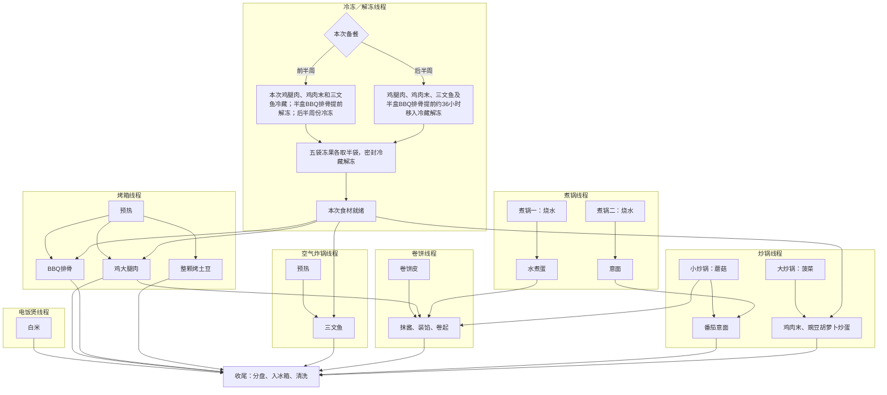

+++
date = '2026-08-30T11:43:05-0400'
title = '减肥饮食锻炼计划'
slug = '06e58c7'
aliases = ['/posts/healthy-eating-plan/']
+++

## 饮食

### 计划表

每天早餐：混合水果约331 g + 高纤维谷物早餐40 g + 无糖豆奶约270 g + 一水肌酸 5g。

| 编号 | 星期 | 餐次 | 碳水 | 蛋白质 | 蔬菜 | 热量（kcal） |
|---|---|---|---|---|---|---:|
| 上1 | 周日 | 晚餐 | 卷饼皮 | 鸡大腿肉2块＋水煮蛋2个 | 蘑菇 | 693 |
| 上2 | 周一 | 午餐 | 白米饭 | 鸡肉末炒蛋2个 | 豌豆胡萝卜 | 659 |
| 上3 | 周一 | 晚餐 | 意面 | 鸡大腿肉1块＋三文鱼1块 | 番茄 | 649 |
| 上4 | 周二 | 午餐 | 烤土豆 | BBQ排骨1/4盒＋三文鱼1块 | 菠菜 | 646 |
| 上5 | 周二 | 晚餐 | 白米饭 | 鸡肉末炒蛋2个 | 豌豆胡萝卜 | 659 |
| 上6 | 周三 | 午餐 | 意面 | 鸡大腿肉1块＋三文鱼1块 | 番茄 | 649 |
| 上7 | 周三 | 晚餐 | 烤土豆 | BBQ排骨1/4盒＋三文鱼1块 | 菠菜 | 646 |
| 下1 | 周四 | 午餐 | 卷饼皮 | 鸡大腿肉2块＋水煮蛋2个 | 蘑菇 | 693 |
| 下2 | 周四 | 晚餐 | 白米饭 | 鸡肉末炒蛋2个 | 豌豆胡萝卜 | 659 |
| 下3 | 周五 | 午餐 | 意面 | 鸡大腿肉1块＋三文鱼1块 | 番茄 | 649 |
| 下4 | 周五 | 晚餐 | 烤土豆 | BBQ排骨1/4盒＋三文鱼1块 | 菠菜 | 646 |
| 下5 | 周六 | 午餐 | 白米饭 | 鸡肉末炒蛋2个 | 豌豆胡萝卜 | 659 |
| 下6 | 周六 | 晚餐 | 意面 | 鸡大腿肉1块＋三文鱼1块 | 番茄 | 649 |
| 下7 | 周日 | 午餐 | 烤土豆 | BBQ排骨1/4盒＋三文鱼1块 | 菠菜 | 646 |
{.table-centered}

滚动备餐：周日午餐饭后做上1–上7；周三晚餐饭后做下1–下7。

### 购物表

<!--
采购口径：全部食材及肌酸从Walmart购买；价格为官网参考价，按周用量分摊，未含税及配送；称重商品以实收净重计，门店库存和售价可能变化。
鸡腿按用户选定的8块、$14.88一盒采购；营养按整盒830g、每块约103.75g生重估算，实重不同须重算。周日、周三各烤4块。Coho三文鱼按每盒2块、320g计算；整周买4盒，周日、周三各做2盒共4块，周三份先冷冻。
特瘦鸡肉末454g每周两盒，前、后半周各做一盒，后半周份购买后冷冻。Swiss Chalet BBQ熟猪背排骨每周一盒600g（含骨和酱汁），每半周各解冻复热半盒，均分到本半周的第4、7盘；暂沿用旧盒450/680的可食比例，估全盒约397g、每餐约99g可食部分，非实测出肉率；营养已改按Swiss Chalet同款标签计算。
Great Value豌豆胡萝卜每周两罐398mL，每半周用一罐，沥干后与鸡肉末、鸡蛋一起炒，均分两顿白米饭餐；营养暂按每罐沥干约260g估算，实收沥干重量优先。冷冻水果每周买5袋共2320g；每半周各袋取半袋，共1160g冷藏解冻，一周全部用于7天早餐。
白米为Great Value Long Grain White Rice 900g。每次量干米120mL（按约0.8g/mL估96g），每周两次共约192g，各均分两餐；每次加水约120mL，作为沿用此前米水体积比1:1的试煮起点。
-->

| 食材 | 商品 | 购买频率 | 每周价格（CAD） |
| --- | --- | ---: | ---: |
| 去骨去皮鸡大腿肉 | [Maple Leaf Boneless Skinless Chicken Thighs Value Pack](https://www.walmart.ca/en/ip/maple-leaf-boneless-skinless-chicken-thighs-value-pack/6000197999724) 8块装；按830 g / 盒估算 | 1盒 / 周 | 约$14.88 |
| BBQ熟猪背排骨 | [Swiss Chalet Smoky BBQ Pork Back Ribs](https://www.walmart.ca/en/ip/swiss-chalet-smoky-bbq-pork-back-ribs-600g/6000197977827) 600 g / 盒，含骨及酱汁；营养暂估397 g可食部分 / 盒 | 1盒 / 周 | 约$12.97 |
| 三文鱼 | [Your Fresh Market Coho Salmon Portions](https://www.walmart.ca/en/ip/Your-Fresh-Market-Coho-Salmon-Portions/6000208252814) 每盒2块，按320 g / 盒计算 | 4盒（8块）/ 周 | 约$41.88 |
| 特瘦鸡肉末 | [Prime Extra Lean Ground Chicken](https://www.walmart.ca/en/ip/Prime-Extra-Lean-Ground-Chicken-Raised-Without-Antibiotics-454-g/10243782) 454 g / 盒 | 2盒 / 周 | $15.96 |
| 鸡蛋 | [Great Value Large Eggs](https://www.walmart.ca/en/ip/Great-Value-Large-Eggs/10052944) 12个 / 盒 | 1盒 / 周 | $3.93 |
| 无糖豆奶 | [Silk Soy Milk Alternative Unsweetened](https://www.walmart.ca/en/ip/Silk-Soy-Milk-Alternative-Unsweetened-Dairy-Free-of-protein/6000190182706) 1.89 L / 桶 | 2桶 / 周 | $9.96 |
| Fresca无糖汽水 | [Fresca Citrus Soda](https://www.walmart.ca/en/ip/Fresca-Citrus-Soda-Pop-Fridge-Pack-Cans-355-mL-12-pack/10277189) 12罐×355 mL / 箱 | 1箱 / 周 | $8.28 |
| 土豆 | [The Little Potato Company Little Yellows（Boomer Gold）](https://www.walmart.ca/en/ip/the-little-potato-company-fresh-little-potatoes-15lb-little-yellows/6000201597418) 680 g / 袋 | 1袋 / 周 | 约$2.74 |
| 豌豆胡萝卜 | [Great Value Peas and Carrots](https://www.walmart.ca/en/ip/Great-Value-Peas-and-Carrots-398-mL/5YDQIJZT1APQ) 398 mL / 罐 | 2罐 / 周 | 约$2.74 |
| 蘑菇 | [Your Fresh Market Sliced Cremini Mushrooms](https://www.walmart.ca/en/ip/mushrooms-sliced-cremini-your-fresh-market/6000196148725) 227 g / 盒 | 1盒 / 周 | $2.44 |
| 嫩菠菜 | [Your Fresh Market Baby Spinach](https://www.walmart.ca/en/ip/baby-spinach-142g/1Z471AOSG7GL) 142 g / 盒 | 4盒 / 周 | $13.76 |
| 番茄意面酱 | [Catelli Garden Select Tomato & Basil Pasta Sauce](https://www.walmart.ca/en/ip/Catelli-Garden-Select-Tomato-Basil-Pasta-Sauce-600-mL-Jar/3B5Q7OZH5XF7) 600 mL / 瓶 | 1瓶 / 周 | $2.67 |
| 冷冻四莓混合水果 | [Great Value 4 Berry Blend](https://www.walmart.ca/en/ip/Great-Value-4-Berry-Blend/40BRV9VQC1J8) 500 g / 袋 | 1袋 / 周 | $4.66 |
| 冷冻莓果樱桃 | [Great Value Berry Cherry Medley](https://www.walmart.ca/en/ip/Great-Value-Berry-Cherry-Medley/7C3ZOZRR30IU) 500 g / 袋 | 1袋 / 周 | $4.66 |
| 冷冻混合水果 | [Great Value Peach, Strawberry and Tropical Fruit Blend](https://www.walmart.ca/en/ip/Great-Value-Peach-Strawberry-and-Tropical-Fruit-Blend/6000191275612) 600 g / 袋 | 1袋 / 周 | $4.66 |
| 冷冻奇异果片 | [Family Delight Frozen Sliced Kiwi](https://www.walmart.ca/en/ip/Family-Delight-Frozen-Sliced-Kiwi-360g-Tropical/1WY6UJQ4FZWK?classType=REGULAR) 360 g / 袋 | 2袋 / 周 | $5.96 |
| 意面 | [Primo Spaghetti](https://www.walmart.ca/en/ip/PRIMO-SPAGHETTI/1YCQ0A4KHLLW) 454 g / 包 | 按需补 | 约$0.45 |
| 全麦卷饼皮 | [Dempster’s 100% Whole Wheat Large Tortillas](https://www.walmart.ca/en/ip/Dempster-s-100-Whole-Wheat-Large-Tortillas/6000191270091) 610 g / 袋，10片（61 g / 片） | 按需补 | 约$0.86 |
| Chipotle蛋黄酱 | [Hellmann’s Mild Chipotle Mayonnaise](https://www.walmart.ca/en/ip/Hellmann-s-Chipotle-Mayonnaise-Mild-Dressing-340ml/5NDTYWNJRQ1Y) 340 mL / 瓶 | 按需补 | 约$0.11 |
| 白米 | [Great Value Long Grain White Rice](https://www.walmart.ca/en/ip/Great-Value-Long-Grain-White-Rice/4UD9P76BEQB4) 900 g / 袋 | 按需补 | 约$0.74 |
| 高纤维谷物早餐 | [Fibre One Crunchy Original](https://www.walmart.ca/en/ip/Fibre-One-Breakfast-Cereal-Crunchy-Original-High-Fibre-and-Whole-Grains-587-g/1OUNWA7P5WCS) 587 g / 盒 | 按需补 | 约$2.61 |
| 黑胡椒 | [Great Value Ground Black Pepper](https://www.walmart.ca/en/ip/Great-Value-Ground-Black-Pepper/10302291) 85 g / 瓶 | 按需补 | 约$0.19 |
| 蒜粉 | [Great Value Garlic Powder](https://www.walmart.ca/en/ip/Great-Value-Garlic-Powder/10303864) 320 g / 瓶 | 按需补 | 约$0.45 |
| 洋葱粉 | [Great Value Onion Powder](https://www.walmart.ca/en/ip/Great-Value-Onion-Powder/10303684) 150 g / 瓶 | 按需补 | 约$0.25 |
| 红椒粉 | [Great Value Paprika](https://www.walmart.ca/en/ip/Great-Value-Paprika/10303778) 130 g / 瓶 | 按需补 | 约$0.36 |
| 干牛至叶 | [Great Value Oregano Leaves](https://www.walmart.ca/en/ip/Great-Value-Oregano-Leaves/6000202666145) 32 g / 瓶 | 按需补 | 约$0.10 |
| 意式混合香草 | [Great Value Italian Seasoning](https://www.walmart.ca/en/ip/Great-Value-Italian-Seasoning/10302881) 50 g / 瓶 | 按需补 | 约$0.09 |
| 盐 | [Windsor Iodized Table Salt](https://www.walmart.ca/en/ip/windsor-table-salt/10210128) 1 kg / 盒 | 按需补 | 约$0.01 |
| 橄榄油 | [Great Value Extra Virgin Olive Oil](https://www.walmart.ca/en/ip/seort/6000203408497) 1 L / 瓶 | 按需补 | 约$0.41 |
| 减盐酱油 | [Great Value Reduced Sodium Soya Sauce](https://www.walmart.ca/en/ip/Great-Value-Reduced-Sodium-Soya-Sauce/6000187053934) 450 mL / 瓶 | 按需补 | 约$0.15 |
| 鸡粉 | [Knorr Chicken Instant Stock Mix](https://www.walmart.ca/en/ip/Knorr-Chicken-Instant-Stock-Mix/10303650) 150 g / 罐 | 按需补 | 约$0.03 |
| 一水肌酸 | [LEANFIT SPORT Creatine Monohydrate — Unflavoured（Walmart）](https://www.walmart.ca/fr/ip/leanfit-sport-creatine-monohydrate-en-poudre-non-aromatis-300-g-5-g-de-cratine-par-portion-certification-informed-choice-cratine-micronise-et-de-quali/6000208594600) 无味，300 g / 罐，参考$27.98 | 按需补 | 约$3.26 |
| 每周合计 | — | — | 约$164 |
{.table-centered}

<!--
维护约定：正文保持简短，保留购物、营养和训练表及商品链接。米饭、意面等取用量写在对应流程，调味量保留在调味表，分盘表均分的只写盘号，不均分的简写盘号和数量。每个厨具线程内同一食材的操作合并为一个条目，不把准备和烹调拆成多个条目。计算依据、饮用分配和隐私信息仅留在隐藏备注；不再追加逐次修改历史。
-->

### 并行做菜流程

<!-- 
1茶匙 = 5 mL；以下时间均为参考。

每周一次买齐整周食材；后半周份生鸡腿肉、生三文鱼、生鸡肉末和半盒排骨购买后即冷冻，烹饪前约36小时移入冷藏解冻。前半周用的半盒排骨提前一日移入冷藏解冻；土豆每次做半周份量，不冷冻。熟餐及时分浅盒降温、全程≤4°C；熟食冷藏建议3–4天，复热至74°C。依据：https://www.canada.ca/content/dam/hc-sc/documents/services/publications/food-nutrition/infographic-leftovers/infographic-leftovers.pdf 。-->

<!--
鸡肉和三文鱼按冷藏状态开始烹调；排骨先在冷藏室解冻，复热中心须达74°C。水煮蛋的蛋白和蛋黄须凝固。安全核对：https://www.canada.ca/en/health-canada/services/general-food-safety-tips/food-safety-you.html 。
-->

#### 任务依赖图

#### 分盘表

| 食材 | 分到第几盘 |
|---|---|
| BBQ排骨 | 4、7 |
| 水煮蛋 | 1放2个 |
| 三文鱼 | 3、4、6、7各1块 |
| 鸡大腿肉 | 1放2块；3、6各1块 |
| 白米饭 | 2、5 |
| 鸡肉末、豌豆胡萝卜炒蛋 | 2、5 |
| 番茄意面 | 3、6 |
| 烤土豆 | 4、7 |
| 全麦卷饼皮 | 1 |
| Chipotle蛋黄酱 | 1 |
| 蘑菇 | 1 |
| 菠菜 | 4、7 |
{.table-centered}

#### 冷冻／解冻线程

1. 前半周：冷冻后半周的鸡腿肉、鸡肉末、三文鱼和半盒排骨；五袋冻果各取半袋（共1,160 g）密封放冷藏解冻，其余继续冷冻。
2. 后半周：提前约36小时将冷冻的鸡腿肉、鸡肉末、三文鱼和半盒排骨移入冷藏解冻；五袋冻果各取剩余半袋密封放冷藏解冻。

#### 电饭煲线程

<!-- 电饭煲 White Rice（白米）模式煮米约50分钟。 -->

1. 白米：量取干米120 mL（约96 g）淘洗沥干，加水约120 mL，用 White Rice（白米）模式煮，约50分钟。

#### 烤箱线程

调味表：

| 食材 | 橄榄油 | 盐 | 黑胡椒 | 蒜粉 | 洋葱粉 | 红椒粉 | 干牛至叶 |
|---|---|---|---|---|---|---|---|
| 鸡大腿肉 | 1/2 茶匙 | 1/8 茶匙 | — | 1/2 茶匙 | 1/2 茶匙 | 1 茶匙 | 1/2 茶匙 |
| 烤土豆 | 1/2 茶匙 | 1/8 茶匙 | 1/8 茶匙 | 1/4 茶匙 | 1/4 茶匙 | — | — |
{.table-centered}

1. 烤箱400°F预热，需15分钟。
2. 鸡大腿肉：取4块擦干、调味，400°F烤27分钟；第1盘的2块切成小块，第3、6盘各放1块。
3. 烤土豆：取半袋340 g，整颗拌调味，铺在烤盘上，400°F烤约30分钟至叉子能轻松刺入；均分到第4、7盘。
4. BBQ排骨：取已解冻的半盒，淋上包装内酱汁、用锡纸包好，400°F烤15–20分钟，确认中心达74°C；第4、7盘各放1/4盒。

#### 空气炸锅线程

调味表：

| 食材 | 橄榄油 | 盐 | 黑胡椒 | 蒜粉 | 洋葱粉 | 红椒粉 | 干牛至叶 |
|---|---|---|---|---|---|---|---|
| 三文鱼 | 1/2 茶匙 | 1/8 茶匙 | 1/2 茶匙 | — | — | 1 茶匙 | — |
{.table-centered}

1. 空气炸锅400°F预热，需4分钟。
2. 三文鱼：取2盒共4块，擦干、调味，400°F烤8分钟至熟透；第3、4、6、7盘各放1块。

#### 煮锅线程

##### 煮锅一

1. 水煮蛋：烧水煮鸡蛋2个，水开后煮约8分钟；掰碎后放第1盘。

##### 煮锅二

1. 意面：烧水煮干面80 g，煮约8分钟。

#### 炒锅线程

调味表：

| 食材 | 橄榄油 | 黑胡椒 | 蒜粉 | 洋葱粉 | 意式混合香草 | 酱油 | 鸡粉 |
|---|---|---|---|---|---|---|---|
| 鸡肉末、豌豆胡萝卜炒蛋 | 1/2 茶匙 | — | 1/4 茶匙 | 1/4 茶匙 | — | 3 茶匙 | 1/8 茶匙 |
| 菠菜 | 1 茶匙 | — | 1/4 茶匙 | 1/4 茶匙 | — | — | — |
| 番茄意面 | 1/2 茶匙 | 1/4 茶匙 | 1/2 茶匙 | — | 1/2 茶匙 | — | — |
| 蘑菇 | 1/4 茶匙 | 1/4 茶匙 | 1/2 茶匙 | 1/2 茶匙 | — | — | — |
{.table-centered}

##### 小炒锅

1. 蘑菇：取半盒约114 g，大火加油、调味，炒约7分钟至熟；放第1盘。
2. 番茄意面：用番茄意面酱半瓶，小火加油、调味，煮2–3分钟；拌入意面煮约3分钟至热透；均分到第3、6盘。

##### 大炒锅

1. 菠菜：取2盒共284 g，大火加油、调味，炒约7分钟至熟；均分到第4、7盘。
2. 鸡肉末、豌豆胡萝卜炒蛋：鸡蛋4个打散；鸡肉末1盒炒散至中心74°C，加入沥干的豌豆胡萝卜1罐炒热，再加入油、蛋液和调味，炒至鸡蛋凝固；均分到第2、5盘。

#### 卷饼线程

1. 全麦卷饼皮抹 Hellmann’s Mild Chipotle 蛋黄酱1茶匙（5 mL）。
2. 加入切块的鸡大腿肉、掰碎的水煮蛋和蘑菇，卷好放第1盘。

### 放纵餐

#### 常见放纵餐
<!--
放纵餐估值依据：均为备选，不计固定饮食。bb.q整份1156kcal来自用户菜单截图；其余五款没有对应整份营养标签，以下为配料拆分估计，非餐厅公布值。
凯撒卷：卷饼约750–1000，加默认薯条350–500kcal；炸鸡汉堡：面包200–250、鸡肉400–550、酱和凉拌菜150–250kcal，不含薯条饮料，买一送一不自动按吃两个算。
鸡排套餐计鸡排、米饭、2个饺子、3块yam配菜、汤沙拉及酱，约1100–1600kcal；yam具体形式未确认。
脆鸡沙威玛卷按Regular整份含两种酱，约750–1050kcal，不套用普通烤鸡卷标签。
1lb烤翅为带骨菜单重量，暂按220–280g熟制带皮可食部分、270–300kcal/100g及50–110kcal酱汁估650–950kcal；骨重、刷油和生熟口径均有误差。
商品与菜单来源见正文链接；这些估计区间不是统计置信区间。
-->

| 食物 | 份量 | 热量（kcal） | 占参考赤字3,730 kcal（额外加吃） | 剩余每周赤字（kcal，额外加吃） | 剩余日均赤字（kcal） |
|---|---|---:|---:|---:|---:|
| [酱蒜无骨炸鸡（bb.q Chicken Soy Garlic Chicken）](https://www.bbqchickenca.com/) | 1整份，1.2 lb | 1,156，菜单标注 | 约31% | 2,573.75 | 367.68 |
| [凯撒鸡肉卷（6IXTY WINGS Chicken Caesar Wrap）](https://6ixtywings.com/menu_items/chicken-caesar-wrap/) | 1个＋默认普通薯条 | 估1,100–1,500 | 约29–40% | 2,229.75–2,629.75 | 318.54–375.68 |
| [炸鸡汉堡（Burger Burger Johnny Cash Chicken）](https://order.online/store/burger-burger-25113744) | 1个 | 估750–1,050 | 约20–28% | 2,679.75–2,979.75 | 382.82–425.68 |
| [炸鸡排套餐（Ozen Sushi Chicken Katsu Combo）](https://www.ubereats.com/ca/store/ozen-sushi/yCgRS0Q7S_Wlx8Flww4rWQ) | 1整套，含米饭、饺子、yam配菜、汤及沙拉 | 估1,100–1,600 | 约29–43% | 2,129.75–2,629.75 | 304.25–375.68 |
| [脆鸡沙威玛卷（Osmow’s Crispy Chicken Shawarma Wrap）](https://osmows.com/nutrition-calculator) | 1个Regular，含蒜酱及OzPotle酱 | 估750–1,050 | 约20–28% | 2,679.75–2,979.75 | 382.82–425.68 |
| 新奥尔良烤翅（Mr. Panda BBQ Sweet Roasted Chicken Wings） | 1整份，1 lb带骨 | 估650–950 | 约17–25% | 2,779.75–3,079.75 | 397.11–439.96 |
| [Pepperoni 披萨（Pizza Pizza，大号）](https://www.pizzapizza.ca/about-us/nutrition/large-pizza/) | 3片 | 约750 | 约20% | 2,979.75 | 425.68 |
| [奥利奥暴风雪冰淇淋（DQ OREO Cookie Blizzard）](https://www.dairyqueen.com/en-ca/nutrition/food-treats/) | 1杯Small | 约670 | 约18% | 3,059.75 | 437.11 |
| [炒饭（Panda Express Fried Rice，美版参考）](https://www.pandaexpress.com/nutritioninformation) | 1份约312 g | 约620 | 约17% | 3,109.75 | 444.25 |
| [肉汁奶酪薯条（Pizza Pizza Classic Poutine）](https://www.pizzapizza.ca/about-us/nutrition/poutine/) | 1份 | 约600 | 约16% | 3,129.75 | 447.11 |
| [巨无霸汉堡（加拿大 McDonald’s）](https://rippedrestaurants.com/ca/chains/mcdonalds/big-mac) | 1个，不含薯条和饮料 | 约570 | 约15% | 3,159.75 | 451.39 |
| [炸鸡汉堡（KFC Famous Chicken Sandwich）](https://assets.ctfassets.net/a2mgcrjjefyo/3AUi2N7aacNo4rjQ1jE3di/4de20ade3ee68d86901ad9d97230accf/KFC_Website_Nutritional_Information__W4_2024_.pdf) | 1个，不含薯条和饮料 | 约540 | 约14% | 3,189.75 | 455.68 |
| [巧克力奶昔（DQ Chocolate Shake）](https://www.dairyqueen.com/en-ca/nutrition/food-treats/) | 1杯Small | 约530 | 约14% | 3,199.75 | 457.11 |
| [陈皮鸡（Panda Express Orange Chicken，美版参考）](https://www.pandaexpress.com/nutritioninformation) | 1份约168 g，不含米饭 | 约510 | 约14% | 3,219.75 | 459.96 |
| [迷你布朗尼（Pizza Pizza Two-Bite Brownies）](https://www.pizzapizza.ca/about-us/nutrition/desserts/) | 6个 | 约480 | 约13% | 3,249.75 | 464.25 |
| [炸鸡（KFC Original Recipe）](https://assets.ctfassets.net/a2mgcrjjefyo/3AUi2N7aacNo4rjQ1jE3di/4de20ade3ee68d86901ad9d97230accf/KFC_Website_Nutritional_Information__W4_2024_.pdf) | 2块鸡大腿，不含配餐和蘸酱 | 约440 | 约12% | 3,289.75 | 469.96 |
| [原味波浪薯片（Wavy Lay’s）](https://www.tastyrewards.com/en-ca/brands/lays/products/wavy-laysr-original-potato-chips) | 75 g | 约420 | 约11% | 3,309.75 | 472.82 |
| [焦糖星冰乐（Starbucks Caramel Frappuccino）](https://fr.starbucks.ca/menu/product/424/iced) | 1杯Grande，473 mL，标准配方 | 约380 | 约10% | 3,349.75 | 478.54 |
| [牧场酱脆鸡卷（DQ Ranch Crispy Chicken Wrap）](https://www.dairyqueen.com/en-ca/nutrition/food-treats/) | 1个 | 约340 | 约9% | 3,389.75 | 484.25 |
| [炸鸡柳（DQ Chicken Strips）](https://www.dairyqueen.com/en-ca/nutrition/food-treats/) | 3条，不含蘸酱 | 约320 | 约9% | 3,409.75 | 487.11 |
| [薯条（DQ Fries）](https://www.dairyqueen.com/en-ca/nutrition/food-treats/) | 1份Regular，不含蘸酱 | 约280 | 约8% | 3,449.75 | 492.82 |
| [炸洋葱圈（DQ Onion Rings）](https://www.dairyqueen.com/en-ca/nutrition/food-treats/) | 1份Regular，不含蘸酱 | 约260 | 约7% | 3,469.75 | 495.68 |
| [香草冰淇淋（DQ Vanilla Cone）](https://www.dairyqueen.com/en-ca/nutrition/food-treats/) | 1个Small甜筒，不加脆皮和配料 | 约230 | 约6% | 3,499.75 | 499.96 |
| [普通雪碧](https://www.coca-cola.com/ca/en/brands/sprite/products) | 1瓶500 mL | 约200 | 约5% | 3,529.75 | 504.25 |
| [普通可口可乐](https://www.repertoirealimentsquebecois.gouv.qc.ca/Produit/Index/8203394) | 1罐355 mL | 约140 | 约4% | 3,589.75 | 512.82 |
{.table-centered}

#### 零卡或低卡放纵餐替代品

以下为可选替代，不计入固定饮食；若额外加吃，仍扣减相应热量赤字。

| 想吃／喝 | 替代品 | 份量 | 热量（kcal） | 占参考赤字3,730 kcal（额外加吃） |
|---|---|---|---:|---:|
| 含糖可乐 | [Coca-Cola Zero Sugar Zero Caffeine](https://www.walmart.ca/en/ip/Coca-Cola-Zero-Sugar-Zero-Caffeine-355mL-Can-12-Pack/6000202941547) | 1罐355 mL | 0 | 0% |
| 汽水，不想要甜味 | [bubly Lime Sparkling Water](https://www.walmart.ca/en/ip/Bubly-Lime-Sparkling-Water-355ml-cans-pack-of-12/6000197924484) | 1罐355 mL | 0 | 0% |
| 含糖冰茶 | [Nestea Zero Sugar Iced Tea](https://www.walmart.ca/en/ip/Nestea-Zero-Sugar-Iced-Tea-473mL/2QW2HXHP2Z41) | 1瓶473 mL | 约10 | 约0.3% |
| 果冻、甜点 | [Jell-O Zero Sugar Strawberry Jelly Powder Mix](https://www.walmart.ca/en/ip/Jell-O-Strawberry-Jelly-Powder-Light-Gelatin-Mix/6000188760145) | 加水制成125 mL | 约10 | 约0.3% |
| 巧克力甜点 | [Snack Pack No Sugar Added Chocolate Pudding Cups](https://www.walmart.ca/en/ip/seort/10287782) | 1杯99 g | 约60 | 约1.6% |
| 香草奶味甜点 | [Snack Pack No Sugar Added Vanilla Pudding Cups](https://www.walmart.ca/en/ip/snack-pack-no-sugar-added-vanilla-pudding-cups/10287875) | 1杯99 g | 约60 | 约1.6% |
| 冰淇淋、雪糕 | [DEL MONTE Strawberry Frozen Fruit Bars](https://www.walmart.ca/en/ip/DEL-MONTE-Strawberry-Frozen-Fruit-Bars-10-x-50-ml/6000202764024) | 1支50 mL | 约50 | 约1.3% |
| 巧克力雪糕 | [Popsicle Fudgsicle Frozen Dairy Dessert Bars](https://www.walmart.ca/en/ip/Popsicle-Fudgsicle-Frozen-Dairy-Dessert-Bars-12-x-60-ml/6000195509106) | 1支60 mL | 约80 | 约2.1% |
| 奶味冰淇淋 | [Halo Top Vanilla Bean Frozen Dessert](https://www.walmart.ca/en/ip/Halo-Top-Vanilla-Bean-Frozen-Dessert/6000199406471) | 125 mL | 约80 | 约2.1% |
| 饼干、脆口零食 | [Quaker Crispy Minis Original Large Brown Rice Cakes](https://www.walmart.ca/en/ip/quaker-crispy-minis-rice-cakes-original/10284949) | 2片，不加抹酱 | 约70 | 约1.9% |
| 薯片、咸脆零食 | [Orville Redenbacher Smart Pop! Microwave Popcorn Mini Bags](https://www.walmart.ca/en/ip/Orville-Redenbacher-Smart-Pop-Mircowave-Popcorn-8-Mini-Bags/206256) | 1迷你袋31 g | 约110 | 约3.0% |
{.table-centered}

<!--
低卡备选按表列份量比较，不计固定采购；替代时只算净热量差，不重复扣减或增加基线赤字。低卡不等于低钠、低饱和脂肪或不限量。
Jell-O仅加水，整盒约4份、40kcal；Smart Pop是31g迷你整袋；米饼按2片；Fudgsicle是加拿大60mL版，不套用美国无添加糖版。Halo Top约80kcal/125mL，非整桶，也非无乳无糖。标签零卡含舍入，配方以实物为准。
补充来源：https://www.conagrabrands.ca/en/brands/snack-pack/sensible-sweets/no-sugar-added-chocolate 、https://halotop.ca/flavours/vanilla-bean/ 。其他来源见商品链接。
-->

## 锻炼

### 计划表

<!-- 
每周训练4天：周一、周二、周四、周五；先力量，后在HIIT、游泳与跑步机中任选一种有氧，每天不叠加。周三、周六、周日完全休息，不安排训练。-->

<!-- 
在家和健身馆力量训练均约48–52分钟（含热身、组间休息和换动作，不含有氧）。推、拉、深蹲、弓步和硬拉组间休息90–120秒；其余动作约60秒，15lb侧平举组间休息90–120秒。单侧动作左右做完算一组，换侧约15秒，再组间休息。总时长为力量训练排程估计，不含有氧及器材排队。-->

| 星期 | 力量训练 | 有氧 |
|---|---|---|
| 周一 | 上肢推拉与核心 | HIIT／游泳／跑步机（三选一） |
| 周二 | 下肢、臀部与核心 | HIIT／游泳／跑步机（三选一） |
| 周三 | 休息 | 休息 |
| 周四 | 上肢推拉与核心 | HIIT／游泳／跑步机（三选一） |
| 周五 | 下肢与核心 | HIIT／游泳／跑步机（三选一） |
| 周六 | 休息 | 休息 |
| 周日 | 休息 | 休息 |
{.table-centered}

- 有氧选项一：HIIT。[Juice & Toya — 20 Minute Full Body Cardio HIIT Workout [NO REPEAT]](https://www.youtube.com/watch?v=M0uO8X3_tEA)。<!-- 全片约29分钟；20个动作，每个50秒、间歇10秒，两轮之间休息约1分钟。-->

| 跟练版本 | 单次总消耗 kcal | 单次净消耗 kcal |
|---|---:|---:|
| 低冲击、简化动作 | 约170–200 | 约130–160 |
| 完整动作、跟上跳跃和节奏 | 约225–280 | 约185–240 |
{.table-centered}

<!-- 净消耗已扣除同期静息消耗。目前以高强度版本为主，做不动时可短暂切换简化动作；完整跟练按约200 kcal／次计入统计。-->

<!--
HIIT实际执行：每次从头到尾完成，主要跟高强度版本，做不动时偶尔短暂跟低强度版本。无法仅凭该描述确定个人实际MET或精确消耗；短暂降强度不等于整套低冲击训练，因此保留约200kcal／次的净消耗规划估值，不对未知的简化动作时长作精确扣减。
HIIT估算依据：视频全长29:02，20×50秒＝16分40秒实际动作；主训练连同短间歇和轮间休息约21分钟，其余约8分钟为热身、放松、讲解。Toya提供简化动作。原链接附带t=508s（8:28），已移除时间戳；从中途开始不适用上述整套估计。
计算体重79kg，净消耗≈体重×Σ[(MET−1)×小时数]；完整版本示例：主训练含间歇平均7.5MET，其余平均2.3MET，79×[(7.5−1)×21/60+(2.3−1)×8/60]≈193.42kcal。阶段平均强度为估算，并非视频或个人实测；低冲击可暂估140kcal净消耗／次，完整版本可暂估200kcal／次。未单独叠加运动后额外消耗。
强度参考2024身体活动能耗汇编：https://pacompendium.com/conditioning-exercise/ 。个人节奏、动作幅度及额外休息会影响实际消耗。旧HIIT模型202.75kcal/次本次归整为约200kcal/次；四次有氧无论选择HIIT、游泳或跑步机，均按规划净消耗共800kcal/周计入，不把三种有氧重复相加。整套低冲击版可能仅约130–160kcal，不保证达到200kcal。
-->

- 有氧选项二：游泳。每个来回自由泳去、蛙泳回；每次20个来回，按25 m泳池计算共1,000 m，预计约30–35分钟<!--（含短暂休息）-->。<!-- 净消耗粗估180–220 kcal，统计按约200 kcal／次；-->
  - 热身：3 个来回，轻松游。
  - 主训练：2 组 × 7 个来回，组间休息30–60秒。
  - 放松：3 个来回，轻松游。

<!--
游泳换算：原计划25个来回约40分钟仅为规划配速，按相同配速20个来回约32分钟；不是用户已测得的完成时间。25m泳池一个来回50m，20个来回1000m，3+2×7+3=20。净消耗≈体重kg×Σ[(MET−1)×小时数]；2024汇编休闲自由泳5.8MET、休闲蛙泳5.3MET，可粗取游动平均约5.5MET，池边休息约1.3MET。以计算体重79kg、实际游动30–34分钟加短休息估计，净消耗约180–200多kcal，规划写约180–220kcal而非实测区间；较长休息、更轻松或明显更快完成时不能套用。记录实际游动与休息时间后再校准。当前统一按200kcal作为HIIT、游泳与跑步机三选一的记账值，未重新估计其他活动或步行频率。
来源：https://pacompendium.com/water-activities/ 。
-->

- 有氧选项三：跑步机。约30分钟，坡度0%
  - 热身：5分钟，4–5 km/h（约2.5–3.1 mph）走路。
  - 主训练：20分钟，约8 km/h（约5 mph）慢跑。
  - 放松：5分钟，逐渐降到3–4 km/h（约1.9–2.5 mph）走路。
<!--
  - 速度以能稳定完成为准；跑不动可降速或跑走交替，不为凑热量硬撑。净消耗粗估约200–230 kcal，统计暂按200 kcal／次；明显降速或缩短时间后需重新估算。-->

<!--
跑步机消耗以计算体重79kg估计，非机器实测。沿用本计划净消耗≈体重×Σ[(MET−1)×小时数]口径，20分钟约8km/h平地慢跑取8.5MET，热身与放松共10分钟粗取3MET，净消耗约223.8kcal；规划按约200–230kcal、记账保守取200kcal。MET为人群平均代理，体能、步态、扶握扶手及设备差异均会改变实际消耗，不能保证个人达到该范围；机器显示值也可能是含静息的总消耗。每周仍为四次有氧三选一，共800kcal净增加，不额外提高消耗或赤字。来源：https://pacompendium.com/running/ ，https://pacompendium.com/walking/ 。
-->

<!--
哑铃标重只计配重片，不计握杆和锁扣：各训练日、各哑铃动作每只15lb，各端配重相同。用户反馈侧平举目前每组约6次，其余动作均可；侧平举改为每周两次、每次3组×6–10次。以动作规范完成的次数计数，不靠摆动凑次数。器械：https://www.amazon.ca/dp/B000VCDXNS 。
-->

### 力量训练（在家）

哑铃配重：每只15 lb。
<!--
卷腹可逐渐改为胸前抱轻哑铃，每组保留1–3次余力，达到次数上限后小幅加重，不套用当天哑铃配重。 -->
<!-- 
腹部训练以增厚为目标，哑铃侧屈左右做完再勾一组；反向卷腹卷起骨盆，不靠摆腿。若持续酸痛影响其他训练或出现腰痛，应减量或调整动作。-->

<!--总时长按完整组数、含5分钟热身估计。-->

<table class="table-centered">
<thead>
<tr><th scope="col">星期</th><th scope="col">总时长</th><th scope="col">动作</th><th scope="col">组数 × 次数／时长</th><th scope="col">每组完成</th><th scope="col">训练肌群</th></tr>
</thead>
<tbody>
<tr>
<th scope="rowgroup" rowspan="7" style="vertical-align: middle; text-align: center;">一</th>
<td rowspan="7" style="vertical-align: middle; text-align: center;">约50–52分钟</td>
<td><a href="https://www.youtube.com/watch?v=WDIpL0pjun0">俯卧撑</a> Push-up</td>
<td>4组 × 8–15 次</td>
<td><label><input type="checkbox" aria-label="周一俯卧撑第1组"> 1</label> <label><input type="checkbox" aria-label="周一俯卧撑第2组"> 2</label> <label><input type="checkbox" aria-label="周一俯卧撑第3组"> 3</label> <label><input type="checkbox" aria-label="周一俯卧撑第4组"> 4</label></td>
<td>胸肌、三头肌、肩前侧</td>
</tr>
<tr>
<td><a href="https://www.youtube.com/watch?v=aI2hGzsAMXs">站姿哑铃肩推</a> Standing dumbbell shoulder press</td>
<td>2组 × 6–10 次</td>
<td><label><input type="checkbox" aria-label="周一站姿哑铃肩推第1组"> 1</label> <label><input type="checkbox" aria-label="周一站姿哑铃肩推第2组"> 2</label></td>
<td>肩前侧、肩外侧、三头肌</td>
</tr>
<tr>
<td><a href="https://www.youtube.com/watch?v=6gvmcqr226U">双哑铃俯身划船</a> Dumbbell bent-over row</td>
<td>4组 × 10–15 次</td>
<td><label><input type="checkbox" aria-label="周一双哑铃俯身划船第1组"> 1</label> <label><input type="checkbox" aria-label="周一双哑铃俯身划船第2组"> 2</label> <label><input type="checkbox" aria-label="周一双哑铃俯身划船第3组"> 3</label> <label><input type="checkbox" aria-label="周一双哑铃俯身划船第4组"> 4</label></td>
<td>背阔肌、上背、肩后侧、二头肌</td>
</tr>
<tr>
<td><a href="https://www.youtube.com/watch?v=PzsMitRdI_8">哑铃侧平举</a> Dumbbell lateral raise</td>
<td>3组 × 6–10 次</td>
<td><label><input type="checkbox" aria-label="周一哑铃侧平举第1组"> 1</label> <label><input type="checkbox" aria-label="周一哑铃侧平举第2组"> 2</label> <label><input type="checkbox" aria-label="周一哑铃侧平举第3组"> 3</label></td>
<td>肩外侧</td>
</tr>
<tr>
<td><a href="https://www.youtube.com/watch?v=H-rqYm0xSZk">哑铃反向飞鸟</a> Dumbbell reverse fly</td>
<td>2组 × 12–20 次</td>
<td><label><input type="checkbox" aria-label="周一哑铃反向飞鸟第1组"> 1</label> <label><input type="checkbox" aria-label="周一哑铃反向飞鸟第2组"> 2</label></td>
<td>肩后侧、上背</td>
</tr>
<tr>
<td><a href="https://www.youtube.com/watch?v=NIqgTCTd2MM">卷腹</a> Crunch</td>
<td>3组 × 10–20 次</td>
<td><label><input type="checkbox" aria-label="周一卷腹第1组"> 1</label> <label><input type="checkbox" aria-label="周一卷腹第2组"> 2</label> <label><input type="checkbox" aria-label="周一卷腹第3组"> 3</label></td>
<td>腹直肌；侧腹辅助</td>
</tr>
<tr>
<td><a href="https://www.youtube.com/watch?v=zQ_IeJkqut8">反向卷腹</a> Reverse crunch</td>
<td>3组 × 10–15 次</td>
<td><label><input type="checkbox" aria-label="周一反向卷腹第1组"> 1</label> <label><input type="checkbox" aria-label="周一反向卷腹第2组"> 2</label> <label><input type="checkbox" aria-label="周一反向卷腹第3组"> 3</label></td>
<td>腹直肌；侧腹辅助</td>
</tr>
</tbody>
<tbody>
<tr>
<th scope="rowgroup" rowspan="6" style="vertical-align: middle; text-align: center;">二</th>
<td rowspan="6" style="vertical-align: middle; text-align: center;">约50分钟</td>
<td><a href="https://www.youtube.com/watch?v=CkFzgR55gho">哑铃高脚杯深蹲</a> Dumbbell goblet squat</td>
<td>4组 × 10–15 次</td>
<td><label><input type="checkbox" aria-label="周二哑铃高脚杯深蹲第1组"> 1</label> <label><input type="checkbox" aria-label="周二哑铃高脚杯深蹲第2组"> 2</label> <label><input type="checkbox" aria-label="周二哑铃高脚杯深蹲第3组"> 3</label> <label><input type="checkbox" aria-label="周二哑铃高脚杯深蹲第4组"> 4</label></td>
<td>大腿前侧、臀部</td>
</tr>
<tr>
<td><a href="https://www.youtube.com/watch?v=Q2k3kYbtOcI">哑铃反向弓步</a> Dumbbell reverse lunge</td>
<td>2组 × 8–12 次／腿</td>
<td><label><input type="checkbox" aria-label="周二哑铃反向弓步第1组"> 1</label> <label><input type="checkbox" aria-label="周二哑铃反向弓步第2组"> 2</label></td>
<td>大腿前侧、臀部</td>
</tr>
<tr>
<td><a href="https://www.youtube.com/watch?v=QFbZevA7dps">哑铃罗马尼亚硬拉</a> Dumbbell Romanian deadlift</td>
<td>3组 × 10–15 次</td>
<td><label><input type="checkbox" aria-label="周二哑铃罗马尼亚硬拉第1组"> 1</label> <label><input type="checkbox" aria-label="周二哑铃罗马尼亚硬拉第2组"> 2</label> <label><input type="checkbox" aria-label="周二哑铃罗马尼亚硬拉第3组"> 3</label></td>
<td>大腿后侧、臀部；下背稳定</td>
</tr>
<tr>
<td><a href="https://www.youtube.com/watch?v=7Ni46OtElu8">臀桥脚跟走步</a> Hamstring walkout</td>
<td>3组 × 6–10 次</td>
<td><label><input type="checkbox" aria-label="周二臀桥脚跟走步第1组"> 1</label> <label><input type="checkbox" aria-label="周二臀桥脚跟走步第2组"> 2</label> <label><input type="checkbox" aria-label="周二臀桥脚跟走步第3组"> 3</label></td>
<td>大腿后侧、臀部</td>
</tr>
<tr>
<td><a href="https://www.youtube.com/watch?v=wxwY7GXxL4k">哑铃双腿提踵</a> Standing dumbbell calf raise</td>
<td>3组 × 12–20 次</td>
<td><label><input type="checkbox" aria-label="周二哑铃双腿提踵第1组"> 1</label> <label><input type="checkbox" aria-label="周二哑铃双腿提踵第2组"> 2</label> <label><input type="checkbox" aria-label="周二哑铃双腿提踵第3组"> 3</label></td>
<td>小腿</td>
</tr>
<tr>
<td><a href="https://www.youtube.com/watch?v=0kSm6-5m7ek">单手哑铃侧屈</a> Dumbbell side bend</td>
<td>3组 × 10–15 次／侧</td>
<td><label><input type="checkbox" aria-label="周二哑铃侧屈第1组（左右）"> 1</label> <label><input type="checkbox" aria-label="周二哑铃侧屈第2组（左右）"> 2</label> <label><input type="checkbox" aria-label="周二哑铃侧屈第3组（左右）"> 3</label></td>
<td>侧腹（腹斜肌）、腰方肌</td>
</tr>
</tbody>
<tbody>
<tr>
<th scope="rowgroup" rowspan="7" style="vertical-align: middle; text-align: center;">四</th>
<td rowspan="7" style="vertical-align: middle; text-align: center;">约48–50分钟</td>
<td><a href="https://www.youtube.com/watch?v=WDIpL0pjun0">俯卧撑</a> Push-up</td>
<td>4组 × 8–15 次</td>
<td><label><input type="checkbox" aria-label="周四俯卧撑第1组"> 1</label> <label><input type="checkbox" aria-label="周四俯卧撑第2组"> 2</label> <label><input type="checkbox" aria-label="周四俯卧撑第3组"> 3</label> <label><input type="checkbox" aria-label="周四俯卧撑第4组"> 4</label></td>
<td>胸肌、三头肌、肩前侧</td>
</tr>
<tr>
<td><a href="https://www.youtube.com/watch?v=aI2hGzsAMXs">站姿哑铃肩推</a> Standing dumbbell shoulder press</td>
<td>2组 × 6–10 次</td>
<td><label><input type="checkbox" aria-label="周四站姿哑铃肩推第1组"> 1</label> <label><input type="checkbox" aria-label="周四站姿哑铃肩推第2组"> 2</label></td>
<td>肩前侧、肩外侧、三头肌</td>
</tr>
<tr>
<td><a href="https://www.youtube.com/watch?v=6gvmcqr226U">双哑铃俯身划船</a> Dumbbell bent-over row</td>
<td>3组 × 10–15 次</td>
<td><label><input type="checkbox" aria-label="周四双哑铃俯身划船第1组"> 1</label> <label><input type="checkbox" aria-label="周四双哑铃俯身划船第2组"> 2</label> <label><input type="checkbox" aria-label="周四双哑铃俯身划船第3组"> 3</label></td>
<td>背阔肌、上背、肩后侧、二头肌</td>
</tr>
<tr>
<td><a href="https://www.youtube.com/watch?v=myKN7H6ju38">阻力带高位下拉</a> Resistance-band lat pulldown</td>
<td>3组 × 10–15 次</td>
<td><label><input type="checkbox" aria-label="周四阻力带高位下拉第1组"> 1</label> <label><input type="checkbox" aria-label="周四阻力带高位下拉第2组"> 2</label> <label><input type="checkbox" aria-label="周四阻力带高位下拉第3组"> 3</label></td>
<td>背阔肌、二头肌</td>
</tr>
<tr>
<td><a href="https://www.youtube.com/watch?v=ddU72Ce0vzo">哑铃弯举</a> Dumbbell biceps curl</td>
<td>2组 × 8–12 次</td>
<td><label><input type="checkbox" aria-label="周四哑铃弯举第1组"> 1</label> <label><input type="checkbox" aria-label="周四哑铃弯举第2组"> 2</label></td>
<td>二头肌、小臂</td>
</tr>
<tr>
<td><a href="https://www.youtube.com/watch?v=PzsMitRdI_8">哑铃侧平举</a> Dumbbell lateral raise</td>
<td>3组 × 6–10 次</td>
<td><label><input type="checkbox" aria-label="周四哑铃侧平举第1组"> 1</label> <label><input type="checkbox" aria-label="周四哑铃侧平举第2组"> 2</label> <label><input type="checkbox" aria-label="周四哑铃侧平举第3组"> 3</label></td>
<td>肩外侧</td>
</tr>
<tr>
<td><a href="https://www.youtube.com/watch?v=0kSm6-5m7ek">单手哑铃侧屈</a> Dumbbell side bend</td>
<td>3组 × 10–15 次／侧</td>
<td><label><input type="checkbox" aria-label="周四哑铃侧屈第1组（左右）"> 1</label> <label><input type="checkbox" aria-label="周四哑铃侧屈第2组（左右）"> 2</label> <label><input type="checkbox" aria-label="周四哑铃侧屈第3组（左右）"> 3</label></td>
<td>侧腹（腹斜肌）、腰方肌</td>
</tr>
</tbody>
<tbody>
<tr>
<th scope="rowgroup" rowspan="6" style="vertical-align: middle; text-align: center;">五</th>
<td rowspan="6" style="vertical-align: middle; text-align: center;">约49分钟</td>
<td><a href="https://www.youtube.com/watch?v=Wcmg-3iHwjQ">哑铃分腿蹲</a> Dumbbell split squat</td>
<td>3组 × 8–12 次／腿</td>
<td><label><input type="checkbox" aria-label="周五哑铃分腿蹲第1组"> 1</label> <label><input type="checkbox" aria-label="周五哑铃分腿蹲第2组"> 2</label> <label><input type="checkbox" aria-label="周五哑铃分腿蹲第3组"> 3</label></td>
<td>大腿前侧、臀部</td>
</tr>
<tr>
<td><a href="https://www.youtube.com/watch?v=_BlxWSGtGXg">支撑式单腿哑铃罗马尼亚硬拉</a> Hand-supported single-leg dumbbell Romanian deadlift</td>
<td>3组 × 10–15 次／腿</td>
<td><label><input type="checkbox" aria-label="周五支撑式单腿哑铃罗马尼亚硬拉第1组"> 1</label> <label><input type="checkbox" aria-label="周五支撑式单腿哑铃罗马尼亚硬拉第2组"> 2</label> <label><input type="checkbox" aria-label="周五支撑式单腿哑铃罗马尼亚硬拉第3组"> 3</label></td>
<td>大腿后侧、臀部；下背稳定</td>
</tr>
<tr>
<td><a href="https://www.youtube.com/watch?v=-NT8jrURSt0">哑铃单腿臀桥</a> Single-leg dumbbell glute bridge</td>
<td>2组 × 10–15 次／腿</td>
<td><label><input type="checkbox" aria-label="周五哑铃单腿臀桥第1组"> 1</label> <label><input type="checkbox" aria-label="周五哑铃单腿臀桥第2组"> 2</label></td>
<td>臀部、大腿后侧</td>
</tr>
<tr>
<td><a href="https://www.youtube.com/watch?v=wxwY7GXxL4k">哑铃双腿提踵</a> Standing dumbbell calf raise</td>
<td>3组 × 12–20 次</td>
<td><label><input type="checkbox" aria-label="周五哑铃双腿提踵第1组"> 1</label> <label><input type="checkbox" aria-label="周五哑铃双腿提踵第2组"> 2</label> <label><input type="checkbox" aria-label="周五哑铃双腿提踵第3组"> 3</label></td>
<td>小腿</td>
</tr>
<tr>
<td><a href="https://www.youtube.com/watch?v=zQ_IeJkqut8">反向卷腹</a> Reverse crunch</td>
<td>3组 × 10–15 次</td>
<td><label><input type="checkbox" aria-label="周五反向卷腹第1组"> 1</label> <label><input type="checkbox" aria-label="周五反向卷腹第2组"> 2</label> <label><input type="checkbox" aria-label="周五反向卷腹第3组"> 3</label></td>
<td>腹直肌；侧腹辅助</td>
</tr>
<tr>
<td><a href="https://www.youtube.com/watch?v=NIqgTCTd2MM">卷腹</a> Crunch</td>
<td>3组 × 10–20 次</td>
<td><label><input type="checkbox" aria-label="周五卷腹第1组"> 1</label> <label><input type="checkbox" aria-label="周五卷腹第2组"> 2</label> <label><input type="checkbox" aria-label="周五卷腹第3组"> 3</label></td>
<td>腹直肌；侧腹辅助</td>
</tr>
</tbody>
</table>

### 力量训练（在健身馆）

<!-- 
与在家方案二选一，不叠加。每周4天，共71个工作组；每次约48–52分钟（含热身及热身组，不含器材排队和有氧）。-->

<!-- 各动作分别选重量，最后一组保留约2次余力；全部工作组达到次数上限后小幅加重，热身组不计入勾选框。-->

<table class="table-centered">
<thead>
<tr><th scope="col">星期</th><th scope="col">总时长</th><th scope="col">动作</th><th scope="col">组数 × 次数／时长</th><th scope="col">每组完成</th><th scope="col">训练肌群</th></tr>
</thead>
<tbody>
<tr>
<th scope="rowgroup" rowspan="7" style="vertical-align: middle; text-align: center;">一</th>
<td rowspan="7" style="vertical-align: middle; text-align: center;">约48–52分钟</td>
<td><a href="https://www.youtube.com/watch?v=z_r6hDOYtO0">史密斯机平板卧推</a> Smith machine bench press</td>
<td>4组 × 8–12 次</td>
<td><label><input type="checkbox" aria-label="健身馆周一史密斯机平板卧推第1组"> 1</label> <label><input type="checkbox" aria-label="健身馆周一史密斯机平板卧推第2组"> 2</label> <label><input type="checkbox" aria-label="健身馆周一史密斯机平板卧推第3组"> 3</label> <label><input type="checkbox" aria-label="健身馆周一史密斯机平板卧推第4组"> 4</label></td>
<td>胸肌、三头肌、肩前侧</td>
</tr>
<tr>
<td><a href="https://www.youtube.com/watch?v=GcY6TZxfS0k">坐姿器械肩推</a> Machine shoulder press</td>
<td>2组 × 8–12 次</td>
<td><label><input type="checkbox" aria-label="健身馆周一坐姿器械肩推第1组"> 1</label> <label><input type="checkbox" aria-label="健身馆周一坐姿器械肩推第2组"> 2</label></td>
<td>肩前侧、肩外侧、三头肌</td>
</tr>
<tr>
<td><a href="https://www.youtube.com/watch?v=TeFo51Q_Nsc">坐姿器械划船</a> Machine seated row</td>
<td>4组 × 10–15 次</td>
<td><label><input type="checkbox" aria-label="健身馆周一坐姿器械划船第1组"> 1</label> <label><input type="checkbox" aria-label="健身馆周一坐姿器械划船第2组"> 2</label> <label><input type="checkbox" aria-label="健身馆周一坐姿器械划船第3组"> 3</label> <label><input type="checkbox" aria-label="健身馆周一坐姿器械划船第4组"> 4</label></td>
<td>背阔肌、上背、肩后侧、二头肌</td>
</tr>
<tr>
<td><a href="https://www.youtube.com/watch?v=JlT2xB92lY8">单臂绳索侧平举</a> Single-arm cable lateral raise</td>
<td>2组 × 12–20 次／侧</td>
<td><label><input type="checkbox" aria-label="健身馆周一单臂绳索侧平举第1组"> 1</label> <label><input type="checkbox" aria-label="健身馆周一单臂绳索侧平举第2组"> 2</label></td>
<td>肩外侧</td>
</tr>
<tr>
<td><a href="https://www.youtube.com/watch?v=nMqQNGo4Jtg">绳索三头下压</a> Cable triceps pushdown</td>
<td>2组 × 10–15 次</td>
<td><label><input type="checkbox" aria-label="健身馆周一绳索三头下压第1组"> 1</label> <label><input type="checkbox" aria-label="健身馆周一绳索三头下压第2组"> 2</label></td>
<td>三头肌</td>
</tr>
<tr>
<td><a href="https://www.youtube.com/watch?v=vpPjY_2Kq1A">器械反向飞鸟</a> Reverse pec deck</td>
<td>2组 × 12–20 次</td>
<td><label><input type="checkbox" aria-label="健身馆周一器械反向飞鸟第1组"> 1</label> <label><input type="checkbox" aria-label="健身馆周一器械反向飞鸟第2组"> 2</label></td>
<td>肩后侧、上背</td>
</tr>
<tr>
<td><a href="https://www.youtube.com/watch?v=CNHS2OoUi30">坐姿器械卷腹</a> Machine abdominal crunch</td>
<td>3组 × 10–15 次</td>
<td><label><input type="checkbox" aria-label="健身馆周一坐姿器械卷腹第1组"> 1</label> <label><input type="checkbox" aria-label="健身馆周一坐姿器械卷腹第2组"> 2</label> <label><input type="checkbox" aria-label="健身馆周一坐姿器械卷腹第3组"> 3</label></td>
<td>腹肌、侧腹</td>
</tr>
</tbody>
<tbody>
<tr>
<th scope="rowgroup" rowspan="6" style="vertical-align: middle; text-align: center;">二</th>
<td rowspan="6" style="vertical-align: middle; text-align: center;">约48–52分钟</td>
<td><a href="https://www.youtube.com/watch?v=fUNkEW3N_ug">史密斯机深蹲</a> Smith machine squat</td>
<td>4组 × 8–12 次</td>
<td><label><input type="checkbox" aria-label="健身馆周二史密斯机深蹲第1组"> 1</label> <label><input type="checkbox" aria-label="健身馆周二史密斯机深蹲第2组"> 2</label> <label><input type="checkbox" aria-label="健身馆周二史密斯机深蹲第3组"> 3</label> <label><input type="checkbox" aria-label="健身馆周二史密斯机深蹲第4组"> 4</label></td>
<td>大腿前侧、臀部</td>
</tr>
<tr>
<td><a href="https://www.youtube.com/watch?v=SRJWDaHqJII">史密斯机反向弓步</a> Smith machine reverse lunge</td>
<td>2组 × 8–12 次／腿</td>
<td><label><input type="checkbox" aria-label="健身馆周二史密斯机反向弓步第1组"> 1</label> <label><input type="checkbox" aria-label="健身馆周二史密斯机反向弓步第2组"> 2</label></td>
<td>大腿前侧、臀部</td>
</tr>
<tr>
<td><a href="https://www.youtube.com/watch?v=nmGzbW15qYo">史密斯机罗马尼亚硬拉</a> Smith machine Romanian deadlift</td>
<td>3组 × 8–12 次</td>
<td><label><input type="checkbox" aria-label="健身馆周二史密斯机罗马尼亚硬拉第1组"> 1</label> <label><input type="checkbox" aria-label="健身馆周二史密斯机罗马尼亚硬拉第2组"> 2</label> <label><input type="checkbox" aria-label="健身馆周二史密斯机罗马尼亚硬拉第3组"> 3</label></td>
<td>大腿后侧、臀部；下背稳定</td>
</tr>
<tr>
<td><a href="https://www.youtube.com/watch?v=QjNFk4F5dAs">俯卧器械腿弯举</a> Lying leg curl</td>
<td>2组 × 10–15 次</td>
<td><label><input type="checkbox" aria-label="健身馆周二俯卧器械腿弯举第1组"> 1</label> <label><input type="checkbox" aria-label="健身馆周二俯卧器械腿弯举第2组"> 2</label></td>
<td>大腿后侧</td>
</tr>
<tr>
<td><a href="https://www.youtube.com/watch?v=FNdI5TynYxs">史密斯机站姿提踵</a> Smith machine standing calf raise</td>
<td>3组 × 12–20 次</td>
<td><label><input type="checkbox" aria-label="健身馆周二史密斯机站姿提踵第1组"> 1</label> <label><input type="checkbox" aria-label="健身馆周二史密斯机站姿提踵第2组"> 2</label> <label><input type="checkbox" aria-label="健身馆周二史密斯机站姿提踵第3组"> 3</label></td>
<td>小腿</td>
</tr>
<tr>
<td><a href="https://www.youtube.com/watch?v=CNHS2OoUi30">坐姿器械卷腹</a> Machine abdominal crunch</td>
<td>3组 × 10–15 次</td>
<td><label><input type="checkbox" aria-label="健身馆周二坐姿器械卷腹第1组"> 1</label> <label><input type="checkbox" aria-label="健身馆周二坐姿器械卷腹第2组"> 2</label> <label><input type="checkbox" aria-label="健身馆周二坐姿器械卷腹第3组"> 3</label></td>
<td>腹肌、侧腹</td>
</tr>
</tbody>
<tbody>
<tr>
<th scope="rowgroup" rowspan="7" style="vertical-align: middle; text-align: center;">四</th>
<td rowspan="7" style="vertical-align: middle; text-align: center;">约48–52分钟</td>
<td><a href="https://www.youtube.com/watch?v=z_r6hDOYtO0">史密斯机平板卧推</a> Smith machine bench press</td>
<td>4组 × 8–12 次</td>
<td><label><input type="checkbox" aria-label="健身馆周四史密斯机平板卧推第1组"> 1</label> <label><input type="checkbox" aria-label="健身馆周四史密斯机平板卧推第2组"> 2</label> <label><input type="checkbox" aria-label="健身馆周四史密斯机平板卧推第3组"> 3</label> <label><input type="checkbox" aria-label="健身馆周四史密斯机平板卧推第4组"> 4</label></td>
<td>胸肌、三头肌、肩前侧</td>
</tr>
<tr>
<td><a href="https://www.youtube.com/watch?v=GcY6TZxfS0k">坐姿器械肩推</a> Machine shoulder press</td>
<td>2组 × 8–12 次</td>
<td><label><input type="checkbox" aria-label="健身馆周四坐姿器械肩推第1组"> 1</label> <label><input type="checkbox" aria-label="健身馆周四坐姿器械肩推第2组"> 2</label></td>
<td>肩前侧、肩外侧、三头肌</td>
</tr>
<tr>
<td><a href="https://www.youtube.com/watch?v=TeFo51Q_Nsc">坐姿器械划船</a> Machine seated row</td>
<td>3组 × 10–15 次</td>
<td><label><input type="checkbox" aria-label="健身馆周四坐姿器械划船第1组"> 1</label> <label><input type="checkbox" aria-label="健身馆周四坐姿器械划船第2组"> 2</label> <label><input type="checkbox" aria-label="健身馆周四坐姿器械划船第3组"> 3</label></td>
<td>背阔肌、上背、肩后侧、二头肌</td>
</tr>
<tr>
<td><a href="https://www.youtube.com/watch?v=JGeRYIZdojU">高位下拉</a> Lat pulldown</td>
<td>3组 × 10–15 次</td>
<td><label><input type="checkbox" aria-label="健身馆周四高位下拉第1组"> 1</label> <label><input type="checkbox" aria-label="健身馆周四高位下拉第2组"> 2</label> <label><input type="checkbox" aria-label="健身馆周四高位下拉第3组"> 3</label></td>
<td>背阔肌、二头肌</td>
</tr>
<tr>
<td><a href="https://www.youtube.com/watch?v=NFzTWp2qpiE">绳索弯举</a> Cable biceps curl</td>
<td>2组 × 10–15 次</td>
<td><label><input type="checkbox" aria-label="健身馆周四绳索弯举第1组"> 1</label> <label><input type="checkbox" aria-label="健身馆周四绳索弯举第2组"> 2</label></td>
<td>二头肌、小臂</td>
</tr>
<tr>
<td><a href="https://www.youtube.com/watch?v=JlT2xB92lY8">单臂绳索侧平举</a> Single-arm cable lateral raise</td>
<td>2组 × 12–20 次／侧</td>
<td><label><input type="checkbox" aria-label="健身馆周四单臂绳索侧平举第1组"> 1</label> <label><input type="checkbox" aria-label="健身馆周四单臂绳索侧平举第2组"> 2</label></td>
<td>肩外侧</td>
</tr>
<tr>
<td><a href="https://www.youtube.com/watch?v=yCB0KSYFgkE">站姿绳索转体</a> Standing cable torso rotation</td>
<td>3组 × 10–15 次／侧</td>
<td><label><input type="checkbox" aria-label="健身馆周四站姿绳索转体第1组"> 1</label> <label><input type="checkbox" aria-label="健身馆周四站姿绳索转体第2组"> 2</label> <label><input type="checkbox" aria-label="健身馆周四站姿绳索转体第3组"> 3</label></td>
<td>侧腹、腹肌</td>
</tr>
</tbody>
<tbody>
<tr>
<th scope="rowgroup" rowspan="6" style="vertical-align: middle; text-align: center;">五</th>
<td rowspan="6" style="vertical-align: middle; text-align: center;">约48–52分钟</td>
<td><a href="https://www.youtube.com/watch?v=qCR9bN3G1t4">坐姿腿举</a> Seated leg press</td>
<td>3组 × 10–15 次</td>
<td><label><input type="checkbox" aria-label="健身馆周五坐姿腿举第1组"> 1</label> <label><input type="checkbox" aria-label="健身馆周五坐姿腿举第2组"> 2</label> <label><input type="checkbox" aria-label="健身馆周五坐姿腿举第3组"> 3</label></td>
<td>大腿前侧、臀部</td>
</tr>
<tr>
<td><a href="https://www.youtube.com/watch?v=xd9m2S_Rw4s">坐姿器械腿屈伸</a> Leg extension</td>
<td>2组 × 10–15 次</td>
<td><label><input type="checkbox" aria-label="健身馆周五坐姿器械腿屈伸第1组"> 1</label> <label><input type="checkbox" aria-label="健身馆周五坐姿器械腿屈伸第2组"> 2</label></td>
<td>大腿前侧</td>
</tr>
<tr>
<td><a href="https://www.youtube.com/watch?v=QjNFk4F5dAs">俯卧器械腿弯举</a> Lying leg curl</td>
<td>3组 × 10–15 次</td>
<td><label><input type="checkbox" aria-label="健身馆周五俯卧器械腿弯举第1组"> 1</label> <label><input type="checkbox" aria-label="健身馆周五俯卧器械腿弯举第2组"> 2</label> <label><input type="checkbox" aria-label="健身馆周五俯卧器械腿弯举第3组"> 3</label></td>
<td>大腿后侧</td>
</tr>
<tr>
<td><a href="https://www.youtube.com/watch?v=SiYiv9lLjdU">史密斯机臀推</a> Smith machine hip thrust</td>
<td>2组 × 10–15 次</td>
<td><label><input type="checkbox" aria-label="健身馆周五史密斯机臀推第1组"> 1</label> <label><input type="checkbox" aria-label="健身馆周五史密斯机臀推第2组"> 2</label></td>
<td>臀部、大腿后侧</td>
</tr>
<tr>
<td><a href="https://www.youtube.com/watch?v=FNdI5TynYxs">史密斯机站姿提踵</a> Smith machine standing calf raise</td>
<td>3组 × 12–20 次</td>
<td><label><input type="checkbox" aria-label="健身馆周五史密斯机站姿提踵第1组"> 1</label> <label><input type="checkbox" aria-label="健身馆周五史密斯机站姿提踵第2组"> 2</label> <label><input type="checkbox" aria-label="健身馆周五史密斯机站姿提踵第3组"> 3</label></td>
<td>小腿</td>
</tr>
<tr>
<td><a href="https://www.youtube.com/watch?v=CNHS2OoUi30">坐姿器械卷腹</a> Machine abdominal crunch</td>
<td>3组 × 10–15 次</td>
<td><label><input type="checkbox" aria-label="健身馆周五坐姿器械卷腹第1组"> 1</label> <label><input type="checkbox" aria-label="健身馆周五坐姿器械卷腹第2组"> 2</label> <label><input type="checkbox" aria-label="健身馆周五坐姿器械卷腹第3组"> 3</label></td>
<td>腹肌、侧腹</td>
</tr>
</tbody>
</table>

<!--
健身馆方案为替代方案，不与在家方案累加；每天工作组19、17、19、16，共71组，单侧动作左右做完计一组。按动作模式及主要肌群匹配相近训练量，不声称组数相同即刺激或能耗完全相等。健身馆方案优先固定器械、绳索和史密斯机：卧推8组、史密斯深蹲4组、史密斯反向弓步2组、史密斯罗马尼亚硬拉3组、单臂绳索侧平举4组。周一绳索三头下压2组、周四绳索弯举2组；周二腿弯举2组，周五腿弯举3组、腿举3组、腿屈伸2组、史密斯机臀推2组；周一、周二、周五各器械卷腹3组，周四绳索转体3组。卷腹改为动态腹部训练，不与原抗伸展稳定动作视为功能完全等同。大腿后侧同时覆盖髋伸和屈膝。固定器械对稳定肌的要求不同，下方肌群训练量表分别统计两种方案。
为减少对专用设备的依赖，侧平举用可调滑轮绳索机，臀推与提踵用史密斯机，卷腹用坐姿腹肌训练机；侧平举单侧左右做完计一组。设备以常规商业健身馆为目标，实际配置需按分店确认；腿弯举可用坐姿或俯卧机型，不要求两台都有。器械可用性参考：https://www.puregym.com/equipment/ 。
训练安排参考ACSM 2026阻力训练指南：https://acsm.org/resistance-training-guidelines-update-2026/ ；动作演示见表内YouTube链接。动作时间为排程估计，器材调节、热身和排队会影响实际时长；本次未据器械更换增加热量消耗或赤字。
-->

### 主要健身肌群示意图





## 睡眠

| 时间 | 安排 |
| --- | --- |
| 23:25 | 调暗灯光，停止屏幕使用 |
| 23:25–23:30 | 洗漱；服用褪黑素 2.5 mg、甘氨酸镁 200 mg |
| 23:30–23:50 | 温和瑜伽 |
| 23:50–00:00 | 冥想 |
| 00:00 | 上床睡觉 |
| 08:30 | 起床 |
| 08:30-08:35 | 洗漱 |
| 08:35-08:40 | 使用 Hume Body Pod |

### 温和瑜伽

23:30–23:50，动作放慢，不拉到疼痛或出汗。

1. 猫牛式 2 分钟：四肢撑地，随呼吸轻轻伸展、拱起背部。
2. 婴儿式 3 分钟：臀部靠向脚跟，身体向前放松；膝盖不适则跳过。
3. 仰卧抱膝 3 分钟：平躺，轻轻抱住双膝。
4. 仰卧扭转左右各 3 分钟：屈膝倒向一侧，肩膀保持放松，不硬压。
5. 平躺放松 6 分钟：自然呼吸，让身体安静下来。

[睡前瑜伽视频参考（约 20 分钟）](https://www.youtube.com/watch?v=v7SN-d4qXx0)

### 冥想

23:50–00:00，坐着闭眼，自然呼吸；从脚到头依次留意身体各处的感觉。走神时轻轻把注意力带回来，不必强迫自己清空思绪。结束后上床睡觉。

[身体扫描冥想视频参考（约 10 分钟）](https://www.youtube.com/watch?v=a_oq9RdPSeY)

视频用于提前学习；睡前按文字步骤练习，不看屏幕。

## 计量统计

### 营养统计

<!--
现行营养计算口径（2026-10-18）：每周Swiss Chalet BBQ熟猪背排骨一盒600g；四顿各用1/4盒150g含骨及酱汁重量。暂沿用旧盒450/680的可食比例，按每周约397.06g、每顿约99.26g熟可食部分计算，非Swiss Chalet公布出肉率；营养向量已用同款标签，实称去骨后可食重量后应重算。特瘦鸡肉末每周两盒共908g生重，均分四顿白米饭餐，每顿约227g；营养总量仍按旧900g代理，待实物标签重算。鸡腿为8块一盒，按830g/周、每块103.75g生重估算，卷饼餐2块207.5g生重、每顿意面1块103.75g生重，不扣修脂；沿用同部位营养代理，非本款实测。其余肉按生重、谷物按干重、土豆按生可食重，豌豆胡萝卜按沥干可食重。Coho三文鱼每周4盒共8块，按每盒320g、全周1,280g、每餐1块160g生重计算，实收净重不同须重算。
豆奶每周两桶、每桶标称1.89L：一桶全部用于7天早餐，早餐按质量称重，前6天各约270g、第7天用尽余量；另一桶用于餐外。1.89L不等于精确的1890g，早餐实际每份质量以该桶净重的1/7为准。营养仍按标称体积计每周3.78L（早餐1.89L、餐外1.89L），因为营养标签按mL标示。Fibre One280g/周，五袋冷冻水果共2320g/周，平均每天早餐约2320/7g。每周12个全蛋，早餐不含蛋；周日、周三各用6个（2个水煮、4个鸡肉末炒蛋）；每顿鸡腿卷饼餐2个水煮蛋，每顿白米饭餐相当于2个炒蛋；土豆餐和意面餐不加蛋。白米约192g干重/周（每次120mL约96g、4餐各约48g），意面160g干重/周（4餐各40g），小土豆按680g生可食重量估算（4餐各170g）；购入后按实称重量均分。
周橄榄油37.5mL，密度0.91g/mL；食盐4.5g，每克钠393.4mg，1茶匙盐暂按6g。油分配mL/周：鱼5、鸡腿5、鸡肉末炒蛋5、土豆5、蘑菇2.5、菠菜10、意面5。每半周蘑菇取半盒约113.5g只给卷饼，菠菜取2盒共284g均分土豆餐；每周蘑菇227g、菠菜568g。排骨酱汁已含在Swiss Chalet标签中，不重复添加。整周鸡肉末炒蛋用油1茶匙、蒜粉1/2茶匙和洋葱粉1/2茶匙，不额外加盐；每周减盐酱油30mL、鸡粉1/4茶匙，Walmart新品牌标签待确认，暂未计入营养；费用已粗估。每周白米约192g干重、鸡蛋12个（水煮4个、鸡肉末炒蛋8个）。干香料合计16.25茶匙，采用原混合代理。锅中未食用的油脂、酱汁尚未实测。
以下营养向量顺序：kcal、蛋白质g、脂肪g、饱和脂肪g、碳水g、纤维g、总糖g、胆固醇mg、钠mg、钙mg、铁mg、钾mg。保留用于后续增减计算；同类食品代理不代表当前品牌实测。
鸡腿/100g：[149,18.6,7.9,1.7,0,0,0,92,62.3,5,0.6,231]
Swiss Chalet Smoky BBQ猪背排骨/140g可食部分：[270,18,14,6,17,1,11,65,660,40,1,350]，每周暂估397.06g，酱汁已计入；同款GTIN 066701009421标签：https://www.repertoirealimentsquebecois.gouv.qc.ca/Produit/Index/8209140 。
养殖Coho三文鱼/100g：[160,21.27,7.67,1.816,0,0,0,51,47,12,0.34,450]；USDA SR28 NDB 15238代理，非本款实测。
特瘦鸡肉末/100g：[120,19,5,2,0,0,0,90,95,10,0,225]，来自第三方Life Smart标签记录；不是新购Prime的实测营养，实物优先。
普通大鸡蛋/个：[70,6,5,1.5,1,0,0,195,65,25,0.875,62.5]
Silk无糖豆奶/250mL：[90,8,4.5,0.5,4,2,1,0,90,300,1,350]
Fresca每周1箱12罐×355mL，共4.26L；按Walmart参考价$8.28/箱计入费用。商品页标示零热量、零糖，热量与赤字不变；355mL罐装的完整营养标签待核，钠等暂未加入统计，不等于不含。豆奶用量保持不变。
Little Yellows（与Boomer Gold同UPC）/110g包装标示：[80,2,0,0,16,2,1,0,0,0,0.75,500]，来源：https://www.littlepotatoes.com/product/little-yellows/ 。每周一袋680g，四餐均分各170g生重；标签所列零值有舍入，不代表绝对不含。按生重计算，空气炸失水不另增热量；每周5mL橄榄油只计一次。Walmart商品：https://www.walmart.ca/en/ip/the-little-potato-company-fresh-little-potatoes-15lb-little-yellows/6000201597418 ，参考价$2.74/袋；实际包装与结账为准。
罐装豌豆胡萝卜/100g沥干可食部分，暂用同类罐头代理：[46,2.56,0.5,0.09,8.45,3.2,2.74,0,258,24,0.91,142]；每罐暂按沥干260g、每周两罐共520g、四顿各130g。Walmart本款配料含糖、盐，营养与沥干重待实物标签及称重核对：https://www.walmart.ca/en/ip/Great-Value-Peas-and-Carrots-398-mL/5YDQIJZT1APQ ；同类罐头代理：https://fdc.nal.usda.gov/food-details/2709686/nutrients 。钠代理可能高估沥干后的实际摄入。
蘑菇/100g：[22,2.5,0.1,0.02,4.3,0.6,1.7,0,6,18,0.4,448]
菠菜/100g：[23,2.86,0.39,0.063,3.63,2.2,0.42,0,79,99,2.71,558]
Catelli番茄酱/125mL：[50,1,1.5,0.2,9,1,5,0,330,20,0.5,350]（纤维1g为代理）
前三袋冷冻混合水果合并代理/100g：[55,0.7,0.2,0.03,13,2,10,0,5,15,0.3,175]，合计1600g/周；各产品水果比例及完整营养标签未核实，非三袋实测。冷冻奇异果两袋共720g/周暂以USDA生奇异果/100g代理：[61,1.14,0.52,0.029,14.66,3,8.99,0,3,34,0.31,312]，非本款实测；来源：https://www.ars.usda.gov/ARSUserFiles/80400535/Data/SR/SR28/reports/sr28fg09.pdf （NDB 09148）。五袋参考价合计$19.94/周；前三袋各$4.66，奇异果两袋各$2.98。
Primo意面/85g：[310,11,1.5,0.4,64,4,2,0,0,20,2.5,175]。每周干面160g，两次各80g、各均分两餐；按Walmart参考价$1.27/454g，分摊约$0.45/周。营养采用同款454g包装的较完整零售标签：https://www.fortinos.ca/en/spaghetti-pasta/p/20731217001_EA ；Walmart页面仅列部分营养，Primo官网数据与零售标签略有差别，实物标签优先。
全麦Large卷饼/61g：[170,5,4,1,28,3,1,0,320,30,1.5,225]，每顿1片；标签来源：https://www.nofrills.ca/en/100-whole-wheat-large-tortillas/p/21424015_EA 。
Hellmann’s Mild Chipotle蛋黄酱/15mL：[35,0.1,3.5,0.3,1,0,1,0,105,0,0,0]。每顿5mL、每周10mL；钾、铁未列标签，此处暂按0计，并非证实绝对不含。配料含添加糖。来源：https://www.hellmanns.com/ca/en/p/chipotle-mayonnaise.html/00068400004097 。
白米/干重100g：[365,7.13,0.66,0.18,79.95,1.3,0.12,0,5,28,0.8,115]。沿用此前USDA SR28 NDB 20444未强化长粒白米代理，非Great Value商品实测；每次120mL、按0.8g/mL估96g，每周两次约192g、每餐约48g干重，淘洗及烹调流失未另扣。来源：https://www.ars.usda.gov/ARSUserFiles/80400535/Data/SR/SR28/reports/sr28fg20.pdf 。
Fibre1/62g：[140,4,1,0.2,53,27,1,0,220,250,8,150]
橄榄油/100g：[884,0,100,13.8,0,0,0,0,2,1,0.56,1]
基础干香料每16茶匙：[118,5.5,2.3,0.4,25,8,2,0,30,130,3.3,550]
未取整周合计：[12506.21131668063,981.5624591803429,451.07921163029744,109.76891370561127,1246.0614952350152,280.4236664530916,334.9290487546927,4750.748739495798,12990.478376592566,7956.137195039304,121.80287520115081,33715.622269277184]。卷饼仅用Chipotle蛋黄酱，每顿5mL；未根据Walmart其他新品牌全面重算，新鸡肉末每周908g而基线为900g。排骨出肉率、罐头沥干重、量杯松紧、品牌标签及锅中弃油造成估算误差。
周消耗维持16235.958333333334kcal：基础及日常14511、力量训练450.9583333333333、有氧800、步行474；周赤字3729.7470166527037、日均532.8210023789577kcal；除7700得理论脂肪等价值约0.484±0.211kg/周（周消耗±1623.60kcal对应），不是实际纯脂肪减量保证。赤字显示两位小数仅为算术精度，须以体重趋势校准；未计放纵餐。
主要来源：
BBQ排骨当前商品见购物表；营养按Swiss Chalet同款标签，出肉率仍为估计。
豆奶：https://www.silkcanada.ca/products/plant-based-beverage/unsweetened-soy-beverage/ 、https://www.provigo.ca/en/soy-milk-alternative-unsweetened-dairy-free/p/20308979_EA
普通蛋代理：https://grayridge.com/recipes-and-nutrition/
番茄酱：https://www.kraftheinz.com/en-CA/catelli/products/00064200010122-garden-select-tomato-basil-pasta-sauce
谷物：https://voila.ca/products/fibre-one-cereal-crunchy-original-587-g/887547EA
白米水量：每次量120mL干米；按此前约0.8g/mL的松散装杯密度，估约96g。沿用用户指定米水体积比1:1，淘洗沥干后加约120mL水作为试煮起点。沿用Toshiba电饭煲White Rice模式，程序结束后单独分盘。米的密度及淘洗后残留水量会改变实际口感，必要时按试煮结果微调加水；营养按估计干重计算。
土豆：商品和规格见购物表，包装注明预洗、无需去皮。每次取半袋整颗烤箱400°F约30分钟，以叉子能刺透为准；油和调味沿用现有表，不冷冻土豆。烤制时间依据：https://www.littlepotatoes.com/product/little-yellows/ 。
卷饼：https://www.walmart.ca/en/ip/Dempster-s-100-Whole-Wheat-Large-Tortillas/6000191270091 ；每片营养标签：https://www.nofrills.ca/en/100-whole-wheat-large-tortillas/p/21424015_EA
鱼：https://www.ars.usda.gov/ARSUserFiles/80400535/Data/SR/SR28/reports/sr28fg15.pdf （NDB 15238）；https://fdc.nal.usda.gov/food-details/173715/nutrients
鸡肉末：https://www.eatthismuch.com/calories/extra-lean-ground-chicken-3342704 （第三方品牌记录，实物标签优先）
其余商品来源见购物表；尚缺本款完整标签的鸡腿、蔬果及香料采用同类参考。
-->

#### 一周营养统计

**热量估计（不含放纵餐）：日均摄入约1,787 kcal、消耗约2,319 ± 232 kcal、赤字约533 ± 232 kcal；对应每周摄入约12,506 kcal、消耗约16,236 ± 1,624 kcal、赤字约3,730 ± 1,624 kcal。按7,700 kcal/kg粗算，理论脂肪等价值约减0.48 ± 0.21 kg／周，不等于实际体重下降量。** [估算局限](https://www.niddk.nih.gov/health-information/professionals/diabetes-discoveries-practice/nih-body-weight-planner)

<!-- 按当前约定，摄入固定为计划值；消耗的“±”暂按10%作规划情景，不是实测误差或95%置信区间。按中心值换算的理论脂肪等价值约0.48 ± 0.21 kg／周，不代表实际纯脂肪减量。 -->

消耗构成（估算）：

| 类型 | 每周 kcal（±10%） | 日均 kcal（±10%） |
|---|---:|---:|
| 基础代谢 | 12,092.50 ± 1,209.25 | 1,727.50 ± 172.75 |
| 日常活动等（久坐系数加成） | 2,418.50 ± 241.85 | 345.50 ± 34.55 |
| 力量训练（净增加） | 450.96 ± 45.10 | 64.42 ± 6.44 |
| 有氧：HIIT、游泳或跑步机，4次／周（净增加） | 800.00 ± 80.00 | 114.29 ± 11.43 |
| 步行（估计每周12 km，净增加） | 474.00 ± 47.40 | 67.71 ± 6.77 |
| 合计 | 16,235.96 ± 1,623.60 | 2,319.42 ± 231.94 |
{.table-centered}

运动按扣除同期基础消耗后的净增加量计入，避免重复计算；日常加成不代表单独测得的食物热效应。

<!--
以下暂按Swiss Chalet排骨整盒约397 g去骨可食部分估算，尚待实称；不含放纵餐。饱和脂肪供能约7.9%（109.8g×9kcal/g÷12,506kcal）；新增酱油、鸡粉及Fresca的钠尚未计入，需按实际产品标签补算。摄入无偏差仅为当前赤字模型约定，不代表标签、食材重量与实际食用量均已核实。-->

| 营养指标 | 每周合计 | 平均每天 | 建议每日范围或目标 |
|---|---:|---:|---|
| 热量 | 约12,506 kcal | 约1,787 kcal | 1,800–2,000 kcal |
| 蛋白质 | 约982 g | 约140.2 g | 130–165 g |
| 总脂肪 | 约451 g | 约64.4 g | 45–65 g |
| 饱和脂肪 | 约109.8 g | 约15.7 g | 11.9 g |
| 饱和脂肪占总热量 | 约7.9% | 约7.9% | ≤6% |
| 碳水化合物 | 约1,246 g | 约178.0 g | 180–240 g |
| 膳食纤维 | 约280 g | 约40.1 g | 30–38 g |
| 总糖 | 约335 g | 约47.8 g | – |
| 添加糖 | 粗估约31–66 g | 粗估约4–9 g | ≤25 g |
| 膳食胆固醇 | 约4,751 mg | 约679 mg | – |
| 钠 | 约12,990 mg | 约1,856 mg | ≤2,300 mg |
| 钙 | 约7,956 mg | 约1,137 mg | 1,000 mg |
| 铁 | 约121.8 mg | 约17.4 mg | 8 mg |
| 钾 | 约33,716 mg | 约4,817 mg | ≥3,400 mg |
| 维生素D | 粗估约159 µg | 粗估约23 µg | 15 µg |
| 维生素B12 | 已计约49.0 µg | 已计约7.0 µg | 2.4 µg |
| 碘 | 粗估800–900 µg | 粗估114–129 µg | 150 µg |
| Omega-3：ALA | 粗估8–9 g | 粗估1.1–1.3 g | 1.6 g |
| Omega-3：EPA+DHA | 约15.4 g | 约2.2 g | 250 mg |
{.table-centered}

<!-- 营养数字是按计划食材和参考数据计算的点估计；按本次约定，不另加摄入误差。加拿大营养标签本身有[舍入与合规容差](https://inspection.canada.ca/en/food-labels/labelling/industry/nutrition-labelling/additional-information/compliance-test)，因此这个建模约定不等于实际摄入已被精确测得。 -->

#### 每餐营养统计

| 餐次 | 热量 kcal | 蛋白质 g | 脂肪 g | 饱和脂肪 g | 碳水 g | 纤维 g | 总糖 g | 胆固醇 mg | 钠 mg | 钙 mg | 铁 mg | 钾 mg |
| --- | ---: | ---: | ---: | ---: | ---: | ---: | ---: | ---: | ---: | ---: | ---: | ---: |
| 每天早餐 | 376 | 14.0 | 6.5 | 0.8 | 83.4 | 27.2 | 33.8 | 0 | 254 | 553 | 7.2 | 1,195 |
| 周二午／周三晚／周五晚／周日午 | 646 | 54.4 | 26.7 | 7.7 | 43.9 | 7.6 | 10.1 | 128 | 877 | 199 | 6.6 | 2,576 |
| 周日晚／周四午 | 693 | 59.2 | 34.5 | 8.2 | 38.1 | 4.6 | 3.6 | 581 | 771 | 126 | 5.4 | 1,403 |
| 周一午／周二晚／周四晚／周六午 | 659 | 61.8 | 23.4 | 8.0 | 51.7 | 5.0 | 3.8 | 594 | 685 | 121 | 3.5 | 884 |
| 周一晚／周三午／周五午／周六晚 | 649 | 60.4 | 25.4 | 5.6 | 43.4 | 3.9 | 7.3 | 179 | 686 | 72 | 3.6 | 1,518 |
| 餐外饮品（日均） | 97 | 8.6 | 4.9 | 0.5 | 4.3 | 2.2 | 1.1 | 0 | 97 | 324 | 1.1 | 378 |
{.table-centered}

<!--
微量营养与目标说明：D为低精度食物代理估算；B12、EPA+DHA为限定来源小计，非完整摄入量；未计入不等于不含。ALA和碘亦为低精度估计，未可靠计入肉类的分项含量，不能根据小幅低于目标诊断不足。
维生素D：此前已计30.12µg/周（旧129.56减去原Atlantic三文鱼904g所计99.44）；现购养殖Coho无可靠实测D数据，暂借用USDA野生Coho生鱼307 IU/85g≈9.03µg/100g，按1,280g/周估115.58µg；12个全蛋按NIH每个约1.1µg估13.2µg；合计约158.9µg/周、22.7µg/天。养殖与野生、饲料和实收鱼重均可能改变实际值，不应将此粗估当成实测摄入或维生素D状态。来源：https://ods.od.nih.gov/pubs/usdandb/VitaminD-Food.pdf 、https://ods.od.nih.gov/factsheets/VitaminD-HealthProfessional/ 。B12已计49.0364µg/周；排骨和鸡肉末的标签资料不全，暂不补入，不代表不含。全蛋也未纳入B12限定来源小计。Coho三文鱼EPA+DHA按每100g约1.206g、全周1,280g计约15.44g，排骨未定量。
碘暂列800–900µg/周：旧估计958.54µg扣去本次取消1.5g加碘盐约114.68µg后为843.86µg，取宽范围；排骨中的盐不假定为加碘盐，肉类碘未可靠定量。加碘盐依据：https://inspection.canada.ca/en/food-labels/labelling/industry/salt ，暂按每克盐76.45µg碘。ALA仍仅粗估8–9g/周（主要来自豆奶、鱼类，油量减少影响小），排骨未可靠计入；未计入不等于零，不能据此诊断不足。
总糖包含天然糖；添加糖粗估约31–66g/周：Swiss Chalet BBQ排骨标签总糖11g/140g，暂估397g可食部计总糖约31g/周；配料含糖、糖浆和糖蜜，暂估其中添加糖约20–35g；Catelli番茄意面酱每周600mL、总糖约24g且配料含糖，暂估添加糖约8–18g；Hellmann’s Chipotle蛋黄酱每周约0.7g糖、配料含添加糖；豌豆胡萝卜罐头配料含糖，暂估两罐合计0–4g添加糖；两片全麦卷饼等其余来源暂估0–2g。范围取整且不是统计置信区间；排骨和罐头均未单列添加糖，实值可能超出范围。Fibre One配料未列糖，混合水果与无糖豆奶的天然糖不算添加糖。来源：https://www.repertoirealimentsquebecois.gouv.qc.ca/Produit/Index/8209140 、https://www.kraftheinz.com/en-CA/catelli/products/00064200010122-garden-select-tomato-basil-pasta-sauce 、https://www.hellmanns.com/ca/en/p/chipotle-mayonnaise.html/00068400004097 、https://www.walmart.ca/en/ip/Great-Value-Peas-and-Carrots-398-mL/5YDQIJZT1APQ 、https://www.canada.ca/en/health-canada/services/nutrients/sugars/using-food-labels.html 。糖已包含在热量中，不重复加热量。铁为摄入量，非吸收量；钠含食品及加盐，但鸡肉末炒蛋所用酱油、鸡粉待补算。
宏量建议为减脂训练的实用范围，不是统一医学阈值。蛋白质目标暂保留130–165g，按79kg约为1.65–2.09g/kg；纤维38g是成年男性AI，不是上限。ALA1.6g是AI，EPA+DHA250mg为成人参考量，二者不能互相替代。饱和脂肪目标按个人血脂背景采用约6%能量，表列11.9g为约1787kcal×6%÷9后的近似。营养目标需结合个体情况，不为追表自行补铁、钾或碘。
依据：
https://www.ars.usda.gov/ARSUserFiles/80400535/Data/Iodine/IODINE_DATABASE_RELEASE_4_PER_100G.pdf
https://ods.od.nih.gov/pubs/usdandb/ALA-Food.pdf.pdf
https://ods.od.nih.gov/factsheets/Omega3FattyAcids-HealthProfessional/
https://ods.od.nih.gov/factsheets/Iodine-HealthProfessional/
https://ods.od.nih.gov/factsheets/VitaminD-HealthProfessional/
https://ods.od.nih.gov/factsheets/VitaminB12-Consumer/
https://www.canada.ca/en/health-canada/services/food-nutrition/healthy-eating/dietary-reference-intakes/tables/reference-values-macronutrients.html
https://pubmed.ncbi.nlm.nih.gov/28698222/
https://www.heart.org/en/healthy-living/healthy-eating/eat-smart/fats/fats-in-foods
https://www.heart.org/en/healthy-living/healthy-eating/eat-smart/sodium/how-much-sodium-should-i-eat-per-day
https://www.canada.ca/en/health-canada/services/nutrients/sugars/using-food-labels.html
https://www.efsa.europa.eu/en/press/news/120727
-->

### 每周训练量统计

<!-- 

只列主要健身肌群，使用常用中英文名称。数字为每周组数，单侧按每侧计；「—」表示没有单独列计，不代表完全没练到。两种方案分别按完整一周统计，不相加；辅助栏列代表性参与或稳定动作，不将其折算为直接训练组数。

统一按增肌目标估计：充足、基本充足、偏少；信息不足时标为「难判断」。假设动作规范、目标肌群受到足够负荷；评价不代表实测效果或最优训练量。-->

#### 在家

| 肌群／常用英文 | 主要：动作与组数 | 辅助：动作与组数 | 训练量水平（估计） |
|---|---|---|---|
| 胸肌 Chest | 俯卧撑8组 | — | 充足 |
| 肩前侧 Front delts | 哑铃肩推4组 | 俯卧撑8组 | 充足 |
| 肩外侧 Side delts | 哑铃侧平举6组 | 哑铃肩推4组 | 基本充足 |
| 肩后侧 Rear delts | 哑铃反向飞鸟2组 | 哑铃划船7组 | 基本充足 |
| 背阔肌 Lats | 哑铃划船7组、阻力带下拉3组 | — | 充足 |
| 斜方肌 Traps | 哑铃划船7组 | 阻力带下拉3组、哑铃肩推4组、哑铃侧平举6组、哑铃反向飞鸟2组 | 基本充足 |
| 二头肌 Biceps | 哑铃弯举2组 | 哑铃划船7组、阻力带下拉3组 | 基本充足 |
| 三头肌 Triceps | — | 俯卧撑8组、哑铃肩推4组 | 基本充足 |
| 小臂 Forearms | — | 哑铃划船7组、哑铃弯举2组、罗马尼亚硬拉3组、支撑式单腿硬拉3组 | 难判断 |
| 腹肌 Abs | 卷腹6组、反向卷腹6组；合计12组 | 俯卧撑8组、高脚杯深蹲4组、哑铃侧屈每侧6组 | 充足 |
| 侧腹 Obliques | 哑铃侧屈每侧6组 | 卷腹6组、反向卷腹6组 | 基本充足 |
| 下背 Lower back | — | 哑铃划船7组、罗马尼亚硬拉3组、支撑式单腿硬拉3组、高脚杯深蹲4组 | 难判断 |
| 臀部 Glutes | 高脚杯深蹲4组、反向弓步2组、罗马尼亚硬拉3组、支撑式单腿硬拉3组、分腿蹲3组、单腿臀桥2组 | — | 充足 |
| 大腿前侧 Quads | 高脚杯深蹲4组、反向弓步2组、分腿蹲3组 | — | 充足 |
| 大腿后侧 Hamstrings | 罗马尼亚硬拉3组、支撑式单腿硬拉3组、臀桥脚跟走步3组 | 单腿臀桥2组 | 基本充足 |
| 小腿 Calves | 哑铃提踵6组 | — | 基本充足 |
{.table-centered}

#### 健身馆

| 肌群／常用英文 | 主要：动作与组数 | 辅助：动作与组数 | 训练量水平（估计） |
|---|---|---|---|
| 胸肌 Chest | 史密斯机卧推8组 | — | 充足 |
| 肩前侧 Front delts | 器械肩推4组 | 史密斯机卧推8组 | 充足 |
| 肩外侧 Side delts | 单臂绳索侧平举4组 | 器械肩推4组 | 基本充足 |
| 肩后侧 Rear delts | 器械反向飞鸟2组 | 器械划船7组 | 基本充足 |
| 背阔肌 Lats | 器械划船7组、高位下拉3组 | — | 充足 |
| 斜方肌 Traps | 器械划船7组 | 高位下拉3组、器械肩推4组、单臂绳索侧平举4组、器械反向飞鸟2组 | 基本充足 |
| 二头肌 Biceps | 绳索弯举2组 | 器械划船7组、高位下拉3组 | 基本充足 |
| 三头肌 Triceps | 绳索三头下压2组 | 史密斯机卧推8组、器械肩推4组 | 基本充足 |
| 小臂 Forearms | — | 器械划船7组、高位下拉3组、绳索弯举2组、史密斯机罗马尼亚硬拉3组 | 难判断 |
| 腹肌 Abs | 器械卷腹9组 | 史密斯机深蹲4组、史密斯机罗马尼亚硬拉3组、绳索转体3组 | 基本充足 |
| 侧腹 Obliques | 绳索转体3组 | 器械卷腹9组 | 偏少 |
| 下背 Lower back | — | 史密斯机深蹲4组、史密斯机罗马尼亚硬拉3组 | 难判断 |
| 臀部 Glutes | 史密斯机深蹲4组、坐姿腿举3组、史密斯机反向弓步2组、史密斯机罗马尼亚硬拉3组、史密斯机臀推2组 | — | 充足 |
| 大腿前侧 Quads | 史密斯机深蹲4组、坐姿腿举3组、史密斯机反向弓步2组、器械腿屈伸2组 | — | 充足 |
| 大腿后侧 Hamstrings | 史密斯机罗马尼亚硬拉3组、器械腿弯举5组 | 史密斯机臀推2组 | 基本充足 |
| 小腿 Calves | 史密斯机提踵6组 | — | 基本充足 |
{.table-centered}

<!--
肌群图由imagegen生成，仅示意主要健身肌群的大致位置，非精细解剖图。训练量评价是假设负荷及动作难度足够的计划估计，非实测；稳定参与不等于增肌充足，单腿硬拉不能完整替代屈膝腿弯举功能。参考：https://acsm.org/resistance-training-guidelines-update-2026/ 。
在家及健身馆力量训练约48–52分钟为含热身、休息和换动作的预算，非连续做功；在家方案周一、周五各卷腹3组、反向卷腹3组，腹直肌合计12组／周。周二、周四哑铃侧屈各每侧3组，合计每侧6组／周。腹部训练以增厚为目标。未因动作变化而机械上调消耗，营养统计暂沿用原保守活动估计，待实际时长与体重趋势校准。
-->

### 趋势追踪

本节只记录最近八周的数据；更早的记录从下列表格移除。训练用时不单独记录，消耗估计以按计划完成力量训练和有氧为前提。

#### 身体组成（Hume Body Pod）

<!-- 起床如厕后、进食饮水前测量；围度用软尺量，原有腰围始终量同一位置。身高（固定参数，cm）：—。腹围量肚脐水平，颈围量喉结下方；正常呼气、不收腹，软尺贴身但不勒紧。男性围度估算体脂率（%）= 495 ÷ [1.0324 − 0.19077 × log₁₀(腹围 − 颈围) + 0.15456 × log₁₀(身高)] − 450，长度均以 cm 计。体重看7日平均值，各种体脂和肌肉估计值看数周趋势，不凭单次读数判断增减肌。[设备指标](https://humehealth.com/pages/hume-pod-v4) · [测量条件](https://humehealth.com/pages/faq) · [围度公式](https://doczz.net/doc/7924325/prediction-of-percent-body-fat-for-us-navy-men-from-body) -->

| 日期 | 体重 kg | Hume 体脂率 % | 腰围 cm | 颈围 cm | 肚脐腹围 cm | 围度估算体脂率 % | 脂肪量 kg | 骨骼肌量 kg | 内脏脂肪（App 数值） | 体水分 % |
|---|---:|---:|---:|---:|---:|---:|---:|---:|---:|---:|
| — | — | — | — | — | — | — | — | — | — | — |
{#body-trend-data .table-centered}

#### 睡眠（Oura Ring）

<!-- 按起床日期记录前一晚的实际睡眠。优先比较总睡眠和作息时间的长期趋势；深睡、REM 的单晚分钟数不列为核心指标。[睡眠指标](https://support.ouraring.com/hc/en-us/articles/5949130374547-Glossary) · [夜间心率与 HRV](https://support.ouraring.com/hc/en-us/articles/360025441974-Heart-Rate-Variability) -->

| 起床日期 | 实际入睡 | 起床时间 | 总睡眠 h | 入睡耗时 min | 睡眠效率 % | 睡眠评分 | 夜间最低静息心率 bpm | 夜间平均 HRV ms |
|---|---|---|---:|---:|---:|---:|---:|---:|
| — | — | — | — | — | — | — | — | — |
{#sleep-trend-data .table-centered}

[private-walking-estimate]: # "私密计算参数，仅留源码：男性26岁、170cm、79kg；Mifflin-St Jeor基础代谢1727.5kcal/日，久坐基础14511kcal/周。活动模型沿用力量137分钟/周、3.5MET；四个训练日有氧在HIIT、游泳与跑步机中三选一，净消耗按200kcal/次、800kcal/周估算，已扣同期静息消耗；周六、周三、周日不安排训练。平均每周3次外出，每次来回步行约4km；按5km/h、3.8MET并扣被替代的1.3MET坐姿，净增474kcal/周。总消耗更新为16235.958333333334kcal/周；基础代谢、力量训练和步行已按79kg计算；运动时长和MET仍为原规划估计，未按实际训练或健身馆器械校准；有氧仍保留约200kcal/次的取整规划值；步行与久坐系数可能重叠，均非实测，以2–4周体重均值校准。正文仅显示每周步行总距离；体格、外出频率和单次距离仍不公开显示。方法：https://pubmed.ncbi.nlm.nih.gov/2305711/ ，https://pacompendium.com/walking/ ，https://pacompendium.com/conditioning-exercise/ 。引用定义不在页面显示，但公开源码仍可被读取。"
